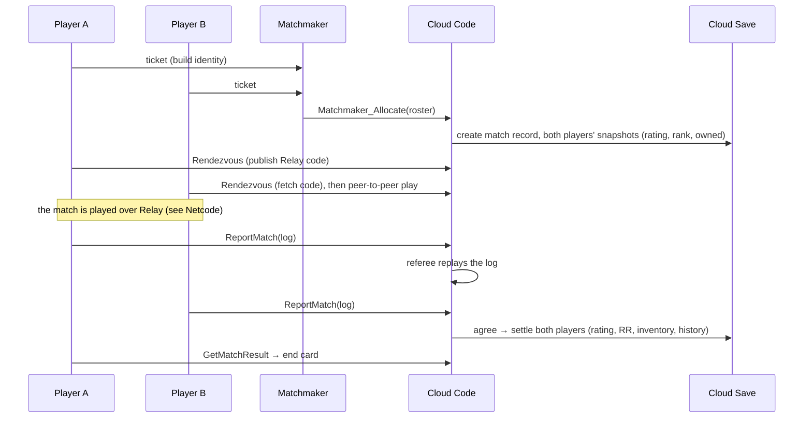

# Backend

> [!question] The question
> Where does a player's data live, who is allowed to change it, and how does a match
> result become a rating change that neither player can fake?

**Where you are:** [[Home]] › **Backend** (realm). Siblings: [[Match]], [[Lobby]]

## The problem

During a match the two peers are equals, and neither can be trusted to decide the result
on its own ([[Match]]). But *something* has to own the things that outlive a match: rating,
rank, inventory, match history, penalties for leaving. It has to be somewhere neither
player controls, it has to survive two players reporting at the same moment, and it has to
stay correct when a phone loses signal halfway through an upload.

## The idea

**Unity Gaming Services (UGS) is the backend: *Cloud Code* (C# functions that run on
Unity's servers) is the only writer, *Cloud Save* (a key-value store) holds the records, and
*Matchmaker* pairs players. Clients only *ask*; the server checks, replays and decides.**

## Where every piece of data lives

This is the map to keep coming back to:

| Data | Lives in | Format | Who writes | Who reads |
|---|---|---|---|---|
| Settings, local profile, loadout choices | Device: `player_profile.json` in `persistentDataPath` | JSON | The client | The client |
| Social and guild samples | `LocalSocialService` / `LocalGuildService` | DTOs in memory | Client placeholders | Lobby UI |
| Last 20 match logs | Device: `MatchLogs/*.nwml` | Binary ([[Match log]] format) | The client | The client (future replays) |
| Unsent ranked logs | Device: `PendingReports/` | Binary | The client | `PendingRankedReports` retries until the server answers |
| Rating, rank, inventory, history (match IDs, stats, recent-match summaries), active match, discipline, wallet, handle profile | Cloud Save, **Protected** player data: keys `rating`, `rank`, `inventory`, `history`, `activeMatch`, `discipline`, `wallet`, `profile` | JSON per key | **Only Cloud Code** | The player (own records), Cloud Code |
| Public profile view (handle, arena, RR, stats, recent history, last played loadout) | Not stored: `GetProfileView` assembles it from the target's protected records | `PublicProfileView` | Cloud Code | Any signed-in player |
| Match record, presence, uploaded logs | Cloud Save, **Private** custom item `match-<id>` | JSON (logs as base64) | Only Cloud Code | Only Cloud Code |
| Queue ticket | Matchmaker | Ticket with `{protocol, sim, content}` | The client creates it | Matchmaker, then the allocator function |
| Relay join code | Inside the match record | String | Cloud Code (from slot 0's call) | Slot 1 via `Rendezvous` |
| Catalog and balance data | Deployed *with* the Cloud Code module (`catalog.json`, balance exports) | JSON | The developer (Editor export plus `ugs deploy`) | Cloud Code |

Two rules fall out of this table:
- **Anything that matters for fairness is server-written.** The client's copy is a display cache.
- **Anything the device stores is either preference or evidence in transit.** Nothing on the device is authoritative.

## How a ranked match flows through it

## Why this, not that

| Option | What you'd gain | What you'd pay | Verdict here |
|---|---|---|---|
| **UGS: Cloud Code + Cloud Save + Matchmaker** (chosen) | No servers to run, built-in auth, pay per use, tight Unity integration | Vendor lock-in. Cloud Save is a key-value store with no cross-player transactions. Platform limits | Chosen |
| Your own server + SQL database (e.g. ASP.NET + PostgreSQL) | Real transactions, queries, full control | You run, patch, secure and scale it, and pay for it 24/7 | Too much operations work for a solo indie today |
| Firebase / PlayFab / Nakama | Similar managed backends | Different trade-offs. Nakama is open source (self-host or hosted), PlayFab has an economy built in | Viable alternatives. UGS fits a Unity-first project |
| Client-authoritative ("trust the game's save file") | Trivial | Any rating can be edited | Never for ranked |

## What it costs later

- **No cross-player transactions.** Settling a match writes two players' records separately.
  The design compensates with idempotency and retries ([[Match settlement]]).
- **Querying is limited.** A key-value store can't answer "top 100 players by RR" by itself.
  A leaderboard needs UGS Leaderboards or another index.
- **Deployment is part of correctness.** The server must have the same catalog and balance
  data as the clients, and the module and queue must be deployed to the right environment.
- **Retention and account deletion** policies are still open.

## Traps

- **Letting the client send a value the server should compute** (a winner, a rating, an owned item).
- **Treating the server's answer as optional.** The UI shows *returned* state, never an
  optimistic guess at rating or grants.
- **Writing without a write lock** when someone else might be writing the same record.

## Patterns you've seen before

- 🔁 [[Never trust the wire]]: the server re-derives everything from the log and its own snapshots.
- 🔁 [[Send intent, not results]]: clients upload logs (intent), and the referee computes the result.
- 🔁 [[Make retries safe]]: every server operation can be repeated without double effects.
- 🔁 [[Pure core, Unity shell]], server edition: pure rules (`NodeWar.Progression`) and storage behind interfaces.

## Check yourself

> [!question]- A player edits their device's `player_profile.json` to say they own every skin. What happens?
> Locally, the lobby might *show* them. But ownership is checked by the server from the
> protected `inventory` record, at equip and at match eligibility, so nothing changes in ranked play.

> [!question]- Why are uploaded logs stored as *Private* custom data rather than on the player's Protected data?
> Logs are evidence. Players mustn't read their opponent's upload before sending their own,
> and the match record must be written only by the server. Private custom items are server-only.

## Go deeper ↓

- [[Cloud]]: the server module and its stores
- [[Match log]]: the evidence format and the referee
- [[Progression]]: rating, rank and catalog rules
- [[Backend client]]: how the game talks to all this

Sideways → [[Key-value stores vs SQL]] · [[Server authority]]

## My understanding

<!-- Yours. AI never edits below this line. -->
