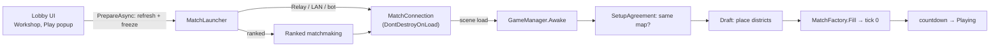

# Lobby

> [!question] The question
> Everything before the first tick: choosing a loadout, finding an opponent, agreeing on a map,
> drafting districts. How does the game hand a "frozen" setup across a scene change, so both
> machines start from the identical tick 0?

**Where you are:** [[Home]] › **Lobby** (realm). Siblings: [[Match]], [[Backend]]

## The problem

The lobby is the messiest place in the game: async server calls, account changes, UI
migrations, players editing loadouts while a match is starting. None of that mess may leak
into the match, which needs one exact, agreed setup on both machines.

## The idea

**Freeze, then hand over. The lobby refreshes server state, freezes the loadout and rank,
stores them on a persistent `MatchConnection` object, and loads the Gameplay scene. From there,
the setup is agreed (map, then draft) through deterministic, catalog-checked steps, and
`MatchFactory` builds tick 0.**

## Where data lives here

| Data | Where | Authority |
|---|---|---|
| Username, settings, local loadout choices | `player_profile.json` (`PlayerProfile`) | The device |
| Rank, owned items, equipped variants | Cloud Save (fetched via `BackendServices`) | Server |
| The frozen launch setup | `MatchConnection` fields, surviving the scene load | Frozen at launch |
| The map | `PremadeMaps.Catalog` (code), identified by ID and `BoardHasher` hash | The shipped build (and the server's copy) |

## Go deeper ↓

- [[Lobby UI]]: pages, local profile, launching ([[Match launch]])
- [[Match flow]]: the composition root and [[Match startup sequence]]
- [[Draft]]: [[Draft turns]]
- [[Board]]: [[Map identity]] and [[Building tick zero]]
- [[Match UI]]: the HUD, node sheets and the [[Three UI stacks]]
- [[Ranked matchmaking]]: the ranked path into a match (thread 3)

## My understanding

<!-- Yours. AI never edits below this line. -->
