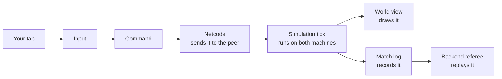

# Match

> [!question] The question
> Two computers run the same battle at the same time. How do they stay in agreement
> for ten minutes without either one being "the server"?

**Where you are:** [[Home]] › **Match** (realm). Siblings: [[Lobby]], [[Backend]]

## The problem

Two players, two machines and perhaps 100 ms of internet between them. For the whole
match both screens must agree on every villager's position, every node's owner and, in
the end, the winner. Neither machine is in charge. When the match ends, a third party
(the [[Backend]]) has to work out who really won without trusting either player.

## The idea

**Both machines run the same deterministic simulation. They exchange only what each
player *did* (commands), never what the game *is* (state).**

If both start from the same tick-0 state and apply the same commands in the same order,
they must reach the same result. That is the "deterministic" part. The rest of this
realm exists to make that guarantee true and to cope when the network makes it hard.

## How it works here

A match has three phases:

1. **Setup.** [[Netcode]] checks that both builds are compatible, [[Draft]] takes turns
   placing districts, and [[Board]] builds the tick-0 state from the map and the picks.
2. **Play.** Ten times a second, a tick runs: [[Input]] turns your gesture into a
   [[Commands|command]], [[Netcode]] gets it to the other machine, [[Simulation]] applies
   both players' commands, and [[World view]] and [[Match UI]] draw the result.
   Presentation reads the state; it never writes it.
3. **End.** [[Simulation]] declares a winner. [[Match log]] holds every command that was
   applied, and for ranked play the [[Backend]] replays that log to confirm the result.

## Why this, not that

| Option | What you'd gain | What you'd pay | Verdict here |
|---|---|---|---|
| **Deterministic lockstep, peer to peer** (chosen) | Bandwidth doesn't grow with army size. Replays come almost free (a replay is the list of commands). Both players get the same latency. No server running during a match | Every line of `Simulation/` must be deterministic (integers only, no `Random`, no clocks). Late input from one player slows both. Desync bugs are hard to find. Both machines know everything | Chosen. Affordable for an indie game, and the referee recovers most of the anti-cheat benefit |
| **Dedicated authoritative server** | Cheating is much harder, joining mid-match is easy and hidden information can stay hidden | You pay for server time every minute of every match and still need prediction code on the clients | Too costly for now. The [[Backend]] referee checks results *after* the match instead |
| **One player hosts as the authority** | Simplest to build | The host gets zero latency, can cheat freely, and the match ends if they leave | Unfair for a ranked 1v1 |

> [!tip] The trade in one line
> Lockstep pays in *discipline* (determinism everywhere) so it doesn't have to pay in
> *money* (servers) or *bandwidth* (sending state).

## What it costs later

- **Every simulation feature inherits the determinism contract.** A new district, unit or
  ability must follow integer-only maths and a fixed tick order. See `docs/contracts/determinism.md`.
- **2v2 and free-for-all.** Lockstep runs at the speed of the slowest player, so every
  added player is another chance to stall. The code also assumes two seats in several
  places: player 0's commands are applied before player 1's, and the peer's slot is computed
  as `1 - localPlayerID`.
- **Hidden information can't be secret.** Both machines hold the full state, so a hacked
  client could reveal anything that isn't shown. Any future fog of war would only be cosmetic.
- **Replays and spectating are nearly free**, because the log already contains everything.
- **Rejoining mid-match is hard.** A returning player needs either the whole command
  history or a snapshot of the state.

## Traps

- Letting presentation code "just set" a state value. One machine changes and the other
  doesn't, and the match has desynced.
- Using `float`, `UnityEngine.Random` or a clock anywhere in `Simulation/`.
- Trusting a machine's claims about itself. [[Netcode]] decides who sent a command from
  the connection it arrived on, never from what the packet says.

## Patterns you've seen before

- 🔁 [[Send intent, not results]]: the founding pattern of this realm.
- 🔁 [[Same code, three places]]: the simulation runs on both peers, in the referee and
  in the balance rig, all built by one `MatchFactory`.

## Check yourself

> [!question]- Why does army size have almost no effect on bandwidth?
> Only commands cross the network. Moving 25 villagers is 25 small commands, sent once,
> however long they then walk. Their positions are never sent, because each machine
> computes them.

> [!question]- Your machine says you won and your opponent's says they won. Which part notices first?
> [[Netcode]] notices during the match: every 50 ticks the peers swap a state hash, and a
> mismatch raises a desync. After the match, the referee receives two logs that disagree,
> marks the result as disputed and settles neither claim.

> [!question]- Why is it sound for the Backend to trust a replay but not a reported winner?
> A reported winner is a claim. A replay is a recomputation: given the same tick-0 state
> and commands, the deterministic simulation can only reach one result. (The limit: a
> client could still fabricate the commands themselves. See [[Netcode]].)

## Go deeper ↓

- [[Netcode]] ✅: getting commands across the internet in time
- [[Input]] ✅: a finger becomes one named gesture
- [[Commands]] ✅: the one door into the game
- [[Simulation]] ✅: the rulebook, in integers
- [[World view]] ✅: turning ticks into smooth pictures
- [[Economy]] ✅: resources, district actions and banks
- [[Bots]] ✅: the scripted opponent and the headless balance rig
- [[Match UI]] ✅ · [[Match flow]] ✅ · [[UI art]] ✅
- Before tick 0: see [[Lobby]] ([[Draft]], [[Board]]); after the match: [[Match log]]

## My understanding

<!-- Yours. AI never edits below this line. -->
