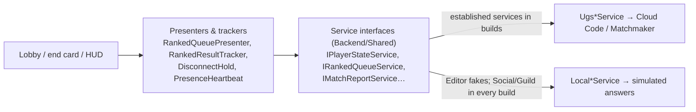

# Backend client

> [!question] The question
> How does the game *talk* to the backend, which can be slow, can fail, can refuse, and can
> answer for a player who has since signed out, without the UI lying or freezing?

**Where you are:** [[Home]] › [[Backend]] › **Backend client** (system)

## The problem

Every server call is asynchronous and can fail. The UI must not freeze while it waits, must
not show results the server didn't accept, must not apply an answer meant for a previous
account, and must keep working offline in the Editor. Uploads must survive the app being
closed mid-send.

## The idea

**Hide the backend behind small async service interfaces. Pick real (UGS) or fake (local)
implementations at start-up. Show only *returned* state. Persist anything that must reach
the server, and retry it until the server gives any answer.**

## How it works here

| Piece | Job |
|---|---|
| `BackendServices` | Picks UGS or local fakes; Social/Guild stay local in every build (profiles are UGS in builds) |
| `LastKnownState` / `StateChanged` | The last state *the server returned*, shown by the UI |
| `RememberGuard` | Drops answers that belong to a previous account |
| `PendingRankedReports` | Saves the ranked log to disk and retries after the match, on lobby load and at queue preflight. Any server answer (even a refusal) removes it. A thrown exception keeps it |
| Queue presenter | Preflight (retry pending reports, check active match, show discipline blocks), ticket, poll every 2 s, up to 3 requeues, bot offer after 90 s |

## Why this, not that

| Decision | Alternative | Why the alternative lost |
|---|---|---|
| Interfaces plus fakes (for tests and offline Editor work) | Call UGS directly from UI | Can't work offline or test presenters without the network |
| Show returned state | Optimistically show "+20 RR" right away | If the server refuses or computes differently, the UI lied |
| Persist uploads to disk | Hold them in memory | Closing the app would lose the evidence, and the match would void |
| Remove a pending upload on *any* answer | Remove only on success | A refusal is final. Retrying a refused log forever wastes calls |

## What it costs later

- **No universal timeout/retry policy** for platform calls yet.
- **Fakes can't reproduce production race conditions.** Server tests cover those instead.
- **Shared DTOs** couple client and server builds.

## Traps

- **Awaiting a service in a MonoBehaviour after it's destroyed.** Check that it's still alive after every `await`.
- **Mistaking placeholders for production data.** Social/Guild use local samples in every build; profiles and the established services use UGS in builds.
- **Forgetting the account check** when an async answer arrives late.

## Patterns you've seen before

- 🔁 [[Pure core, Unity shell]]: the presenters are pure and the views are Unity.
- 🔁 [[Make retries safe]]: pending reports retry, and the server's guards make the retries harmless.

## Check yourself

> [!question]- The phone dies just after a ranked win, before the upload. What happens to the result?
> The log was saved in `PendingReports`. On the next launch (lobby load) it's retried. If it
> arrives within the server's window, the match settles normally. If not, the server will
> have voided it, and the answer clears the pending file.

## Go deeper ↓

- [[Ranked matchmaking]] · [[Disconnect holds]]
- Scripts: [[BackendServices]] · [[PendingRankedReports]] · [[RankedQueuePresenter]]

Agent card: `docs/systems/backend-client.md`

## My understanding

<!-- Yours. AI never edits below this line. -->
