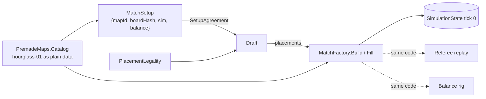

# Board

> [!question] The question
> Two players, a server referee and a balance rig all need *the same* starting board. Where does the map come from, how does everyone prove it's the same one, and who builds tick 0?

**Where you are:** [[Home]] › [[Lobby]] › **Board** (system)

## The problem

Lockstep needs identical tick-0 states ([[Deterministic lockstep]]). If the host could send "here's my board", a cheater could send a board of their own. If each place that starts a match (live game, referee, rig, tests) built the board its own way, they'd drift apart, and the referee would reject every honest log.

## The idea

**Maps ship as code (`PremadeMaps`, the catalog), identified by ID plus a fingerprint (`BoardHasher`). Placement has exactly one rule (`PlacementLegality`). Tick 0 has exactly one builder (`MatchFactory`), used by the live game, the referee, the rig and the tests.**

## How it works here

| Piece | Job |
|---|---|
| `BoardConfigData` | Plain map data: grid size, terrain per cell (Land / Lake / Ocean), district-slot mask, fixed placements (the Cores), base draft pools, starting resources, path tuning |
| `PremadeMaps` | The shipped catalog (`IBoardCatalog`), one map today: `hourglass-01`. Each call returns a fresh copy |
| `MatchSetup` | What's agreed before the draft: map ID, board hash, simulation version, balance hash ([[Map identity]]) |
| `PlacementLegality.CanPlace` | *The* spatial rule: an empty district slot, not a Core; Land for ordinary districts, Lake for Piers, never Ocean |
| `MapAuthoringRules` | Two levels of strictness: "buildable at all" (what the factory needs), and "a shippable map" (mirrored, 14–20 nodes, Cores connected by land) |
| `MatchFactory` | Board + draft + players → tick-0 `SimulationState` ([[Building tick zero]]) |

## Why this, not that

| Decision | Alternative | Why the alternative lost |
|---|---|---|
| Maps in a shipped catalog, referenced by ID | The host sends the board over the network | Any board could be sent; the server couldn't vouch for it |
| One builder for everyone | Each caller sets up its own state | Copies drift. A referee board that differs by one link rejects honest logs |
| One placement rule | Draft UI, network receive, timeout and bot each check placement themselves | They'd disagree about the map; one of them would let an illegal placement through |
| Plain data (`BoardConfigData`) | Unity `ScriptableObject`s in the simulation | Unity types can't enter `Simulation/`; the referee has no Unity |

## What it costs later

- **New maps are new code + a server deploy.** The referee must ship the same catalog.
- **`Configure` and `Build` are separate calls.** Forgetting `Configure` (static balance) is a real way to get a wrong match.
- **Static configuration** means one match per process at a time (rig runs in sequence, referee takes a lock).
- **Any change to tick-0 construction is a simulation-version change** (old replays would build differently).

## Patterns you've seen before

- 🔁 [[Same code, three places]]: `MatchFactory` is the canonical example.
- 🔁 [[Never trust the wire]]: the board is never received, only *named* and checked against the local catalog.
- 🔁 [[Pure core, Unity shell]]: `BoardConfigData` is plain; the Unity `BoardConfig` asset just holds one.

## Check yourself

> [!question]- Why does the board hash cover starting resources and path multipliers, not just terrain?
> Those numbers change what happens from tick 0 onwards. Two "same terrain" boards with different starting food would desync just as surely.

## Go deeper ↓

- [[Map identity]] · [[Building tick zero]]
- Scripts: [[MatchFactory]] · [[PlacementLegality]] · [[BoardHasher]] · [[MatchSetup]] · [[PremadeMaps]]

Agent card: `docs/systems/board.md`

## My understanding

<!-- Yours. AI never edits below this line. -->
