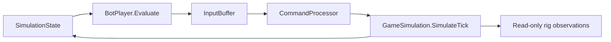

# Bots

> [!question] The question
> How can the same scripted opponent play a local match and help diagnose balance without a Unity window?

**Where you are:** [[Home]] › [[Match]] › **Bots** (system)

## The problem

A local opponent needs decisions, but giving it a private route to mutate the game would create a second rules implementation. Balance work adds another need: repeat the opponent's behaviour across many starting drafts without waiting for rendered matches.

A repeatable opponent is useful evidence. It is still one policy: its blind spots affect every result.

## The idea

**Make the bot a command producer, then drive the same bot and simulation from a headless loop for repeatable comparisons.**

## How it works here

| Piece | Responsibility |
|---|---|
| [[Bot priorities]] | Choose urgent work first, reserve units and reduce repeated orders |
| [[BotSuitChoice]] | Choose an affordable drafted combat suit; prefer Warrior |
| [[Headless balance matches]] | Prepare seeded drafts, swap seats, apply commands, tick and report |
| [[MatchRunner]] | Own the headless lifecycle; stop on game-over or tick cap |

`Evaluate()` runs emergency defence, interception, paid respawns, node defence, expansion, military and economy management in that order. It queues intent stamped with the current tick. [[TickRunner]] drives the live bot; the rig links the actual `BotPlayer.cs`, `BotSuitChoice.cs` and `InputBuffer.cs` into its console project rather than copying them.

The CLI defaults to 100 seeds, cap 6000 ticks, delay 0 and seat swapping on: 200 matches. Its default extra district is Barracks. The comment explains why: “BotPlayer cannot equip a soldier without one”. Loaded balance content is separate from the defaults in [[GameBalanceData]].

## Why this, not that

| Choice | What you gain | What you pay |
|---|---|---|
| Scripted priorities | Inspectable decisions and a stable baseline | Handwritten thresholds and incomplete strategy |
| Ordinary commands | The same legality checks as a human | A chosen action may be refused when it applies |
| Headless execution with linked source | Repeatable runs without rendering or duplicated bot logic | No evidence about live controls, animation or feel |
| Seat-swapped pairs | Compare one draft from both seats | Twice the matches; deterministic ID ties can still favour a seat |
| A learning policy instead | Could discover strategies outside the script | Requires a training setup and a different evaluation problem |

## What it costs later

The current bot emits Move, Equip and Respawn. It does not Recruit, SetAutoRecruit, forge minions, upgrade a Fortress or remotely Collect. New-district runs therefore cannot establish how well a player could exploit those actions.

Runs are sequential because simulation configuration is process-global. More CPU cores do not make simultaneous matches in one process safe. New policy code also needs careful separation between per-evaluation reservations and longer-lived movement cooldowns.

## Traps

- Calling a capped match a win for whoever owns more nodes. The runner records `winner = -1` if the game has not ended.
- Taking “three soldiers” as a game rule. It is the bot's wolfpack threshold.
- Treating matching results as proof of fun or optimal play. The policy itself shapes the experiment.

## Patterns you've seen before

- 🔁 [[Send intent, not results]]: the bot queues actions rather than editing positions or resources.
- 🔁 [[Pure core, Unity shell]]: decisions and simulation can run without Unity.
- 🔁 [[Same code, three places]]: linking source keeps the rig's opponent aligned with the live one.

## Check yourself

> [!question]- With seat swapping on, does `--matches 10` run 10 games?
> It runs 10 seeds and 20 games, one original and one mirrored match per draft.

> [!question]- Does a Forge-heavy balance run test a skilled minion strategy?
> No. This bot never forges a minion. The run measures this policy under that content, not the full strategic value of the district.

## Go deeper ↓

- [[Bot priorities]] → [[BotPlayer]] · [[BotSuitChoice]]
- [[Headless balance matches]] → [[MatchRunner]]

Sideways → [[Economy]] · [[Commands]] · [[The tick]]

## My understanding

<!-- Yours. AI never edits below this line. -->
