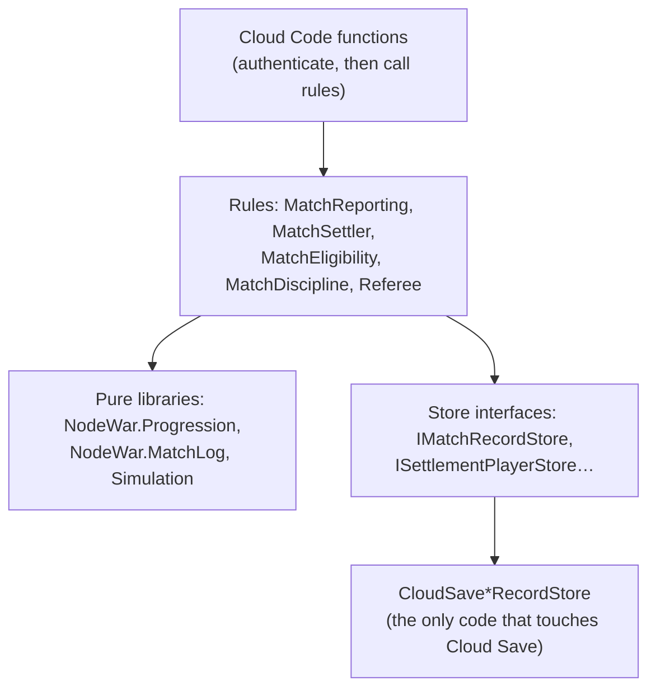

# Cloud

> [!question] The question
> What runs on Unity's servers, what does it own, and how does it stay correct when two
> players call it at the same moment?

**Where you are:** [[Home]] › [[Backend]] › **Cloud** (system)

## The problem

The server has to hand out matches, remember who is in them, take two uploaded logs, decide
who won, update two players' ratings, and handle people who leave, hold or never report.
It is *serverless*: each call is a short-lived function with no memory between calls, and
two calls can run at once on different machines.

## The idea

**Keep all state in Cloud Save records. Make every function read, decide with pure rules,
then write *conditionally* (with a write lock), retrying from a fresh read on conflict.
Trust only the authenticated caller ID, the server's own clock and the server's own data.**

## How it works here

The module `NodeWarCloud` exposes these functions to the game:

| Function | What it does |
|---|---|
| `GetPlayerState` | Creates missing records (including the wallet), grants the starter kit and returns your state |
| `Equip` | Validates ownership and arena, under the inventory write lock |
| `Matchmaker_Allocate` / `_Poll` | Called by Matchmaker (not players). Creates the match record and pre-match snapshots |
| `Rendezvous`, `ConfirmConnected` | Swap the Relay code through the record, and confirm both peers connected |
| `ReportMatch` | Upload a log. Eligibility, then the referee, then agreement, then settlement ([[Match settlement]]) |
| `GetMatchResult`, `GetMatchHistory`, `GetProfileView` | Read results for the end card, history (with opponent names), and any player's public profile: handle, arena, RR, stats, recent matches |
| `Presence`, `ResolveHold`, `LeaveMatch` | Disconnect handling, forfeits and abandonment discipline |
| `VerifyMatch` | Referee only, no settlement |

Under the functions, the layers are:

The store interfaces are why `NodeWarCloud.Tests` can test allocation, conflicts and
partial settlement with in-memory fakes.

## Why this, not that

| Decision | Alternative | Why the alternative lost |
|---|---|---|
| Use `context.PlayerId` (authenticated) | A player ID parameter | Anyone could act for anyone |
| Allocate the match record *before* play | Create it from the first report | The first reporter would choose the roster, and snapshots taken at settlement would let ratings move mid-match |
| Optimistic write locks with retry | Assume calls never overlap | Two reports *do* arrive together. Without locks, one silently overwrites the other |
| Idempotency guards (`SettledMatchIds`) | Cross-player transactions | Cloud Save has none. Making a repeat harmless is the substitute |
| Server presence for disconnects | Infer fault from silence on both sides | When the link breaks, both peers see silence. Only a third party can tell who left |

## What it costs later

- **No atomic "create if absent."** The first creation of a record across concurrent workers
  is a known gap. The code fences it with an existing key's lock where it can.
- **Unsigned logs.** A client could fabricate a consistent log for both players. The referee
  proves consistency, not authorship.
- **Cleanup isn't designed yet**: old match records, logs and account deletion mid-settlement.
- **Every record field is a compatibility promise** between client and server builds (shared DTOs).

## Traps

- **Reading the clock from the client.** Use server time.
- **Writing without the lock from the same read** that made the decision.
- **Releasing claims before discipline is written.** That ordering is deliberate.

## Patterns you've seen before

- 🔁 [[Never trust the wire]]: the caller is authenticated, and everything else is re-derived.
- 🔁 [[Make retries safe]]: settlement, allocation and uploads can all be repeated.
- 🔁 [[Same code, three places]]: the referee runs the same simulation as the peers.

## Check yourself

> [!question]- Both players call `ReportMatch` within the same 50 ms. Walk through what prevents a lost report.
> Each call reads the match record and its write lock, adds its report, and writes with that
> lock. One write wins. The other gets a conflict, which raises `RecordConflictException`, so it
> re-reads the record (now containing the first report), adds its own, and writes again. If
> both are accepted and agree, settlement starts.

> [!question]- Why does the Matchmaker allocator reject calls carrying a *player* identity?
> Allocation must come from Matchmaker, server to server. A player calling it directly could
> invent a roster.

## Go deeper ↓

- [[Player records in Cloud Save]]: the data model
- [[Match settlement]]: from two reports to two rating changes
- [[Write locks]]: how concurrent writes are made safe
- [[Ranked matchmaking]]: queue, then allocation, then rendezvous
- [[Disconnect holds]]: who left, decided by the server
- Scripts: [[MatchAllocation]] · [[MatchRendezvous]] · [[MatchHold]] · [[MatchReporting]] ·
  [[MatchEligibility]] · [[MatchSettler]] · [[MatchRecord]] · [[CloudSavePlayerRecordStore]] ·
  [[CloudSaveMatchRecordStore]]

Agent card: `docs/systems/cloud.md`

## My understanding

<!-- Yours. AI never edits below this line. -->
