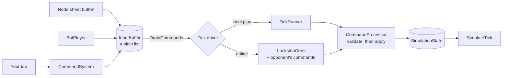

# Commands

> [!question] The question
> What is the *only* way anything (a tap, a UI button, the bot, a replay) is allowed to
> change the game, and why does it have to be only one way?

**Where you are:** [[Home]] › [[Match]] › **Commands** (system)

## The problem

Many things want to change the game: your taps, the node sheet's Recruit button, the bot,
the opponent's packets, a replay file, the server's referee. If each of them changed
`SimulationState` its own way, the two machines would drift apart, replays would be
impossible, and nobody could say what the game's rules actually are.

## The idea

**Every change to the game is a `GameCommand`: six integers that name an action. Commands
are queued, delivered in an agreed order, then *checked again* by `CommandProcessor` at the
moment they are applied.**

## How it works here

The vocabulary is nine actions:

| # | Command | In plain words |
|---|---|---|
| 1 | Move | Send villager *v* to node *n* |
| 2 | SetAllocation | Set a Forge's conversion amount |
| 3 | Equip | Put a suit on villager *v* |
| 4 | Respawn | Pay to bring a dead villager back now |
| 5 | Recruit | Recruit at Village *n* |
| 6 | SetAutoRecruit | Turn repeat-recruiting on or off |
| 7 | UpgradeFortress | Upgrade Fortress *n* with materials or metal |
| 8 | ForgeMinion | Forge a minion at Workshop *n* |
| 9 | Collect | Start or cancel collecting from bank *n* |

The walkthrough is in [[Command pipeline]].

## Why this, not that

| Decision | Alternative | Why the alternative lost |
|---|---|---|
| One flat struct of six ints | A class per command type with its own fields | Fixed size makes the wire and log formats trivial (24 bytes each). The price is that `value` means different things for different commands |
| Validate when applying | Validate only in the UI | Online, a command is applied two or more ticks after it is issued. By then the villager may be dead or the node lost, so the UI's check is stale |
| Absolute toggles (`value = 1` means on) | Relative flips ("toggle") | If a command is ever delivered or applied twice, "set to on" is still correct. "Flip" would undo itself |
| UI and input can't touch state | UI writes state directly "for responsiveness" | One machine changes and the other doesn't, and the match desyncs. Responsiveness comes from *previews* instead ([[Pending orders]]) |

## What it costs later

- **Overloaded fields.** `value` is an allocation amount, a suit, a currency or an on/off
  flag depending on `type`. Unused fields follow conventions (`villagerID = -1`), not
  types. A typed command schema would remove that class of mistake.
- **UI checks duplicate processor checks.** `CommandEligibility` greys out buttons using
  its own reading of the rules, and those can drift from what the processor enforces.
- **Adding a command touches six places in one commit:** the enum, `IsKnown`, a processor
  case, serializer acceptance, the match-log tag and tests.

## Traps

- **Treating `MoveIssued` as "the move happened".** It means *queued*. The simulation can
  still refuse it.
- **Forgetting `issuedOnTick`.** Every producer stamps `state.tickCount`, because lockstep
  must agree on *when* an order was given, not just what it was.
- **Reordering the buffer.** The order of commands within a tick is itself a gameplay
  input, and both machines must apply them in the same order.

## Patterns you've seen before

- 🔁 [[Send intent, not results]]: commands *are* intent.
- 🔁 [[Presentation reads, never writes]]: the buffer is the one door in.
- 🔁 [[Never trust the wire]]: the processor rechecks everything, even your own commands.

## Check yourself

> [!question]- You order a villager to move, and it dies in combat 100 ms later, before your command is applied. What happens?
> The command reaches `ProcessMoveCommand`, which checks `villager.state == Dead` and
> returns without changing anything. Nothing breaks, and the provisional route times out
> on screen ([[Pending orders]]).

> [!question]- Why is `SetAutoRecruit` "set to 0 or 1" rather than "toggle"?
> Setting is idempotent: applying it twice gives the same result as applying it once.
> Toggling twice cancels itself out. Idempotent commands survive retries, duplicates and
> confused UI.

## Go deeper ↓

- [[Command pipeline]]: one Move command from tap to state
- Scripts: [[CommandSystem]] (builds) · [[InputBuffer]] (queues) · [[CommandProcessor]] (validates and applies)

Sideways → [[Netcode]] (how commands cross the wire) · agent card: `docs/systems/commands.md`

## My understanding

<!-- Yours. AI never edits below this line. -->
