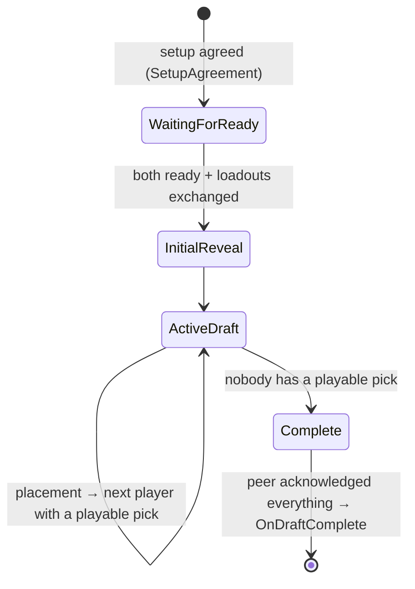

# Draft

> [!question] The question
> Before real-time play, players take turns placing districts on the map. How do two machines stay in agreement about every placement, including what happens when someone's turn timer runs out?

**Where you are:** [[Home]] › [[Lobby]] › **Draft** (system)

## The problem

The draft happens *before* the simulation exists, so it can't use the tick/command machinery. It's turn-based over the same unreliable network ([[UDP vs TCP]]). Packets get lost, players stall, timers expire, and some picks may have no legal cell left. Whatever happens, both peers must finish with exactly the same list of placements, because that list builds tick 0.

## The idea

**A pure `DraftState` holds the rules (whose turn, which picks are left, which cells are legal). A `DraftManager` MonoBehaviour owns clocks, networking and retries. A presenter interface draws it. Placements travel as *district identity + cell* and are re-validated on arrival; timeouts pick a cell from a seed both peers can compute.**

## How it works here

- **P0 drafts first.** Each player's pool = applicable map base districts + their loadout's districts (`LoadoutMatchSetup.DistrictPool`).
- **The active peer** validates locally, applies, and sends `DraftPlacement {player, district, x, z, wasTimeout}` (18 bytes).
- **The receiving peer** checks phase, seat and turn, then `AcceptReceived` spends *the first unspent pick of that district type*, if the cell is legal. A refused packet spends nothing.
- **Reliability:** every packet the peer must see is resent until acknowledged (`DraftAck` is cumulative: "I have N placements"). Completion waits for all acks.
- **Timeouts:** a still-legal *parked* piece wins; otherwise the lowest playable pick goes to a cell chosen from seed `turnNumber × 7919 + playerID × 31`: replicated state only, so both peers compute the same cell.
- **Unplayable picks are skipped,** not forced (a Pier with no lake slot left stays in hand, costing nothing).

## Why this, not that

| Decision | Alternative | Why the alternative lost |
|---|---|---|
| Send district type, not slot index | Send "my pick #2" | Each peer resolves its own equivalent pick. Slot order is local presentation |
| Seeded timeout choice | `Random` or "first legal cell" | `Random` desyncs; "first cell" is predictable and exploitable. The seed comes from shared state |
| Pure rules + MonoBehaviour orchestrator | All in one MonoBehaviour | Rules become testable (`DraftLegalityTests`) and reusable by the bot and the rig |
| Presenter interface | Manager drives a specific UI | Two UI stacks (uGUI and UI Toolkit) exist; either can draw the same draft |

## What it costs later

- **The manager is crowded**: retries, clocks, bot picks and world helpers in one class.
- **Packet handoff to gameplay is delicate.** The draft and the match share one inbound queue, so the manager must stop polling before the tick driver takes over, or it swallows gameplay packets.
- **Duplicate district picks** rely on "first unspent" resolution; richer per-pick data (skins per pick?) would need a stronger wire identity.

## Patterns you've seen before

- 🔁 [[Make retries safe]]: cumulative acks, repeat packets are no-ops.
- 🔁 [[Never trust the wire]]: every received placement is re-validated.
- 🔁 [[Pure core, Unity shell]]: `DraftState` vs `DraftManager`.
- 🔁 [[Send intent, not results]]: placements, not the resulting board.

## Check yourself

> [!question]- Why seed the timeout with `turnNumber × 7919 + playerID × 31` instead of the clock?
> The clock differs on each machine; turn number and player ID are replicated draft state, so both peers pick the identical cell (`.claude/rules/simulation.md`: "Nothing may be seeded from wall-clock time").

## Go deeper ↓

- [[Draft turns]]
- Scripts: [[DraftState]] · [[DraftManager]] · [[DraftSerializer]] · [[LoadoutMatchSetup]]

Agent card: `docs/systems/draft.md`

## My understanding

<!-- Yours. AI never edits below this line. -->
