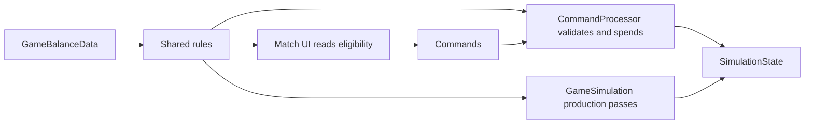

# Economy

> [!question] The question
> How do territory and workers become resources and reinforcements, while the buttons and both simulations agree on what is affordable?

**Where you are:** [[Home]] › [[Match]] › **Economy** (system)

## The problem

A Recruit button needs to show whether an action is possible. The command processor must check again when it applies. Automatic recruitment needs the same answer. Three independently written checks would eventually disagree: a button might promise a body that the simulation refuses to create.

Resources also have different journeys. A Farmer pays the player directly; a Storehouse fills a bank on the board. Treating both as “income” hides the rules that make territory worth contesting.

## The idea

**Keep tuning and read-only decisions shared, then let commands and the ordered tick passes make the changes.**

## How it works here

| Route | What it turns into what | Default in code |
|---|---|---|
| [[Worker production]] | Farm → food; Mine → materials; Forge converts materials → metal | 2 workers per node; 30/40/50 ticks per worker cycle |
| [[Storehouse collection]] | Healthy owned Storehouse → bank → player pools | 5-unit bank, 80 ticks per unit before tempo |
| [[District actions]] | Food → Village body; metal → Workshop minion; materials or metal → Fortress level | Recruit starts at 6 food; minion costs 3 metal |

These are `GameBalanceData.Default()` values, not a promise about an exported balance. Its player caps are 30 food, 30 materials and 10 metal. Zero or negative caps mean uncapped. Suit and district entries are selected by type and era, falling back to era 0.

Health is another economic gate. [[DistrictHealth]] checks full health for positive-max districts. A damaged Storehouse cannot produce just because its owner has not changed. [[PierGate]] makes a district affect travel rather than income: an enemy Pier blocks onward departure except toward the unit's previous node.

## Why this, not that

| Choice | What you gain | What you pay |
|---|---|---|
| Shared eligibility and arithmetic | UI, manual commands and automatic actions consult the same rules | Rules must stay read-only and callers still need explicit writes |
| Type-and-era tables | Variant tuning without a different simulation for each arena | Missing entries and duplicate ordering need deliberate semantics |
| Banks beside direct worker income | Stock exists on territory and can be collected or captured | More timers, locks and ownership reset rules |
| Separate UI price calculations instead | Easy to write a button in isolation | Prices drift when tuning or eligibility changes |

## What it costs later

Adding an action spans helpers, command mutation and presentation. Adding a mutable economic field also needs state copying and hashing; adding tuning needs balance hash coverage and matching exports. Ownership changes must reset the right things without erasing persistent history such as Town payout bits.

The installed simulation balance is static. A helper such as [[DistrictHealth]] reads that installed value, so passing a different balance to another helper does not create an isolated match.

## Traps

- Counting only living units for the population cap. `CountPopulation` includes dead units and minions, excluding consumed units.
- Assuming all district numbers are active. The source labels Village's `bonusVillagersOnClaim` “Historical JSON field; inactive on Village.” Town uses its own field.
- Letting [[Match UI]] write state because a shared rule returned true. Approval is a query; mutation still goes through [[Commands]].

## Patterns you've seen before

- 🔁 [[Presentation reads, never writes]]: the UI can explain a refusal without owning the action.
- 🔁 [[Same code, three places]]: the economy rules run wherever the simulation runs.

## Check yourself

> [!question]- Does a dead body free a population slot for Recruit?
> No. Dead but unconsumed units still count. Death does not create recruitment room before the dead return.

> [!question]- Why can a correct button still lead to a refused command?
> Eligibility was true when it was drawn. Resources, enemies or cooldowns can change before application. The processor checks the authoritative state again.

## Go deeper ↓

- [[Worker production]] → [[GameBalanceData]]
- [[District actions]] → [[NodeActionRules]] · [[DistrictHealth]] · [[PierGate]]
- [[Storehouse collection]] → [[BankRules]]

Sideways → [[The tick]] · [[CommandProcessor]] · [[NodeSheetContent]]

## My understanding

<!-- Yours. AI never edits below this line. -->
