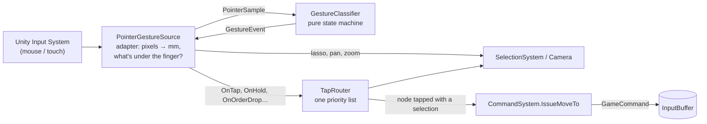

# Input

> [!question] The question
> A finger touches glass and moves. How does the game decide whether that was a tap, a
> pan, a lasso, a zoom or an order, and decide it *once*, so that two systems never disagree?

**Where you are:** [[Home]] › [[Match]] › **Input** (system)

## The problem

One touch could mean a dozen things. A 3 mm wobble during a tap shouldn't become a pan. A
tap on a node means "move here" when villagers are selected, but "show me this node" when
they aren't. The same thumb works on a 6-inch phone and a 27-inch monitor. Before this
system was reorganised, three separate scripts each looked at the same press and guessed
what the others would do with it. That order of guessing was the real rulebook, and
nobody had written it down.

## The idea

**Turn raw pointer samples into one named gesture, using physical distances (millimetres)
rather than pixels, in a pure class with no Unity in it. Then route that gesture to exactly
one consumer, through one explicit priority list.**

## How it works here

- **[[Gesture recognition]]** is the state machine: *Pending → Panning / Lassoing /
  Ordering / HoldFired*, decided by how far (4 mm) and how long (0.3 s) the finger moved.
- **`TapRouter`** is the priority list for taps, written as a ladder of cases:
  1. a villager under the finger wins over the node beneath it;
  2. a node with a selection active is a **move order**;
  3. a node with no selection opens the **inspect** panel;
  4. empty ground clears everything.
- **Input never changes the game.** Its last step is to put a `GameCommand` into the
  `InputBuffer`. What happens next is the job of [[Commands]].

## Why this, not that

| Decision | Alternative | Why the alternative lost |
|---|---|---|
| Millimetres, using the screen's DPI | Pixels | 20 px is a sloppy tap on a phone and a hand twitch on a 4K monitor. Millimetres mean the same thing to a finger everywhere |
| One pure classifier | Each system reads the mouse itself | Systems disagree about the same press, and you can't test any of it without a running scene |
| An explicit priority ladder (`TapRouter`) | Whichever script happens to run first wins | The rules exist either way. Writing them down makes them readable and changeable |
| Villagers select on *release* | Select on *press* | A press might become a pan. Selecting on press would select things by accident |

## What it costs later

- **Every gesture slot is persisted.** Bindings are saved in the player's settings, so slot
  IDs are append-only and the settings format has its own version number (6), separate from
  the network protocol.
- **Node taps wait.** With double and triple tap on nodes enabled (the default), a single
  tap on a node waits 0.22 s to check whether a second tap is coming. That adds directly
  to how long an order takes to feel acknowledged. See [[Pending orders]].
- **The camera still reads some devices directly** (middle-drag, scroll), so there are two
  paths for input to keep in agreement.

## Traps

- **Reading `Input` or `Mouse.current` in a new script** to "just check a click". That
  brings back the three-way guessing this system removed.
- **Writing state from input code.** Input reads state (who is selectable?) and writes only commands.
- **Pixel thresholds.**

## Patterns you've seen before

- 🔁 [[Pure core, Unity shell]]: `GestureClassifier` has no device, scene or clock of
  its own. Time and positions arrive in `PointerSample`s, so tests feed in synthetic finger traces.
- 🔁 [[Presentation reads, never writes]]: input is presentation's front door.
- 🔁 [[Send intent, not results]]: the output of this whole system is a 24-byte intent.

## Check yourself

> [!question]- The classifier uses `float` everywhere. Doesn't that break determinism?
> No. Determinism is only required *inside the simulation*. Input's floats decide which
> command to create, and the command itself is all integers. The command is the boundary.
> Each machine may have classified the gesture slightly differently, but only one machine
> issued it, and everyone applies the same 24 bytes.

> [!question]- You tap a node with nothing selected, then a node with three villagers selected. What does `TapRouter` do each time?
> First tap: rung 3, which opens the node's inspect panel. Second tap: rung 2, which calls
> `CommandSystem.IssueMoveTo(node)` and creates three Move commands (one per villager).

## Go deeper ↓

- [[Gesture recognition]]: the state machine and its thresholds
- Scripts: [[GestureClassifier]] · [[PointerGestureSource]] · [[TapRouter]] · [[SelectionSystem]]

Sideways → [[Commands]] (where the output goes) · agent card: `docs/systems/input.md`

## My understanding

<!-- Yours. AI never edits below this line. -->
