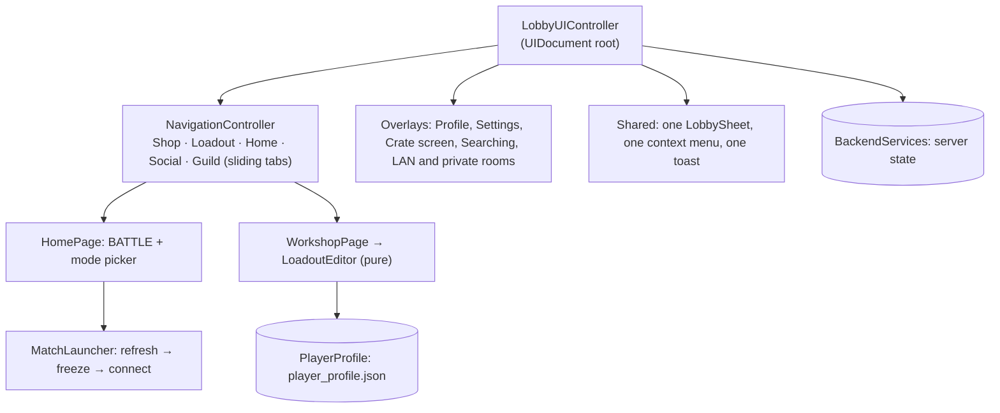

# Lobby UI

> [!question] The question
> The lobby shows your rank, lets you edit your loadout, and starts matches. How does it show *server* truth without confusing it with *local* preferences, and stay correct when answers arrive late?

**Where you are:** [[Home]] › [[Lobby]] › **Lobby UI** (system)

## The problem

The lobby mixes two kinds of data that look alike on screen: things the player owns on the server (rank, inventory, equipped variants) and things saved on the device (username, settings, which slots they've filled). It talks to a backend that can be slow, offline, or answer for an account that just signed out. And it's mid-migration between two UI systems.

## The idea

**Server state is only ever *displayed* (as returned); local choices live in `PlayerProfile`. Launching a match *freezes* a snapshot of both. The UI is built with UI Toolkit as one shell with shared navigation, sheets, menus and toasts; the old uGUI lobby stays one checkbox away.**

## How it works here

| Piece | Job |
|---|---|
| `LobbyUIController` | Builds the shell; "reads no simulation state and writes none" (there is none yet) |
| `NavigationController` | Pages side by side in one track; changing tab *slides* it. Every page stays in the tree, so scroll position survives for free |
| `ShopPage` / `CrateScreen` | Shop stalls share claim panels; held crates open fullscreen and reveal each returned reward before Accept. Purchases only log |
| `SocialPage` / `ProfilePage` | Independent async TV, friends and match-history sections (history lives here, not on its own page). Profiles open from `GetProfileView` and keep unknown stats as dashes; social actions log. Replay is still a stub. Self keeps server Rename |
| Notifications bell | Opens a notifications overlay. It is meant for things like a friend sending you a replay; that is not built yet |
| `GuildPage` / `GuildChatScreen` | Search/filter/preview and session-cached public browse; members see weekly progress, pinned/feed posts and fullscreen plain-text chat. Testing toggles sample membership |
| `LoadoutEditor` | Pure slot rules (fill first empty, refuse duplicates, clear), testable in `NodeWar.Lobby.Tests` |
| `PlayerProfile` | Local JSON at `persistentDataPath/player_profile.json`, with migration of old save shapes |
| `MatchLauncher` | Refresh rank → sanitise and freeze the loadout → host/join (Relay, LAN, ranked) or start local ([[Match launch]]) |
| `LobbyManager.useUIToolkitLobby` | The scene checkbox choosing new vs legacy lobby ([[Three UI stacks]]) |

## Why this, not that

| Decision | Alternative | Why the alternative lost |
|---|---|---|
| Freeze launch data | Read rank and loadout live during connection | An async rank update could reshape a match that's already connecting |
| Shared sheet, menu, toast instances | Each page has its own modal stack | Overlapping modals, inconsistent dismiss behaviour |
| Keep legacy uGUI compiling behind a toggle | Delete it on migration | A broken new lobby can be switched off in the Inspector mid-session |
| Pure editor/rules classes | Rules inside page MonoBehaviours | Testable without Unity; the old uGUI panel "expresses the same rules… where they cannot be tested at all" |

## What it costs later

- **Local profile still carries legacy progression fields** (trophies, unlock arrays) next to the real server data.
- **Shop, invites, replays and box flows are placeholders** without backends.
- **Two lobby stacks** mean two launch paths to keep compatible until the legacy one is deleted.

## Patterns you've seen before

- 🔁 [[Pure core, Unity shell]]: `LoadoutEditor`, `LoadoutRules`, presenters.
- 🔁 [[Server authority]]: rank and inventory shown as returned, never guessed.

## Check yourself

> [!question]- You change your loadout in the Workshop while a ranked queue is already searching. Which loadout does the match use?
> The one frozen by `MatchLauncher.PrepareAsync` when you started. Later edits don't reach a match in flight.

## Go deeper ↓

- [[Match launch]] · [[Three UI stacks]]
- Scripts: [[MatchLauncher]] · [[PlayerProfile]] · [[LoadoutEditor]] · [[NavigationController]]

Agent card: `docs/systems/lobby-ui.md`

## My understanding

<!-- Yours. AI never edits below this line. -->
