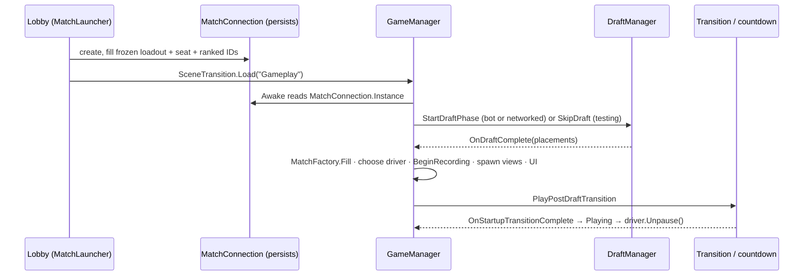

# Match flow

> [!question] The question
> Who *assembles* a match: picks the tick driver, builds the views, starts recording, and makes sure nothing is left ticking or listening when the match ends?

**Where you are:** [[Home]] › [[Lobby]] › **Match flow** (system). Also part of [[Match]].

## The problem

Every other system is a part; something must put the parts together in the right order and take them apart cleanly. Start the tick driver before the countdown and players move during "3-2-1". Forget an unsubscribe and a destroyed view throws every tick. Lose the connection mid-draft, mid-match or on the end card, and each case must end *once*, with the right result.

## The idea

**`GameManager` is the composition root of the Gameplay scene: it reads the frozen setup from `MatchConnection`, runs a small phase machine (PreDraft → Drafting → PostDraft → Countdown → Playing), builds everything through shared factories, and owns teardown. Drivers stay paused until the startup sequence completes.**

## How it works here

- **Driver choice:** networked → `LockstepCore` driven from `GameManager.Update` with Unity's clocks; local/bot → `TickRunner`.
- **Recording:** drafted matches subscribe `MatchRecorder` to the driver's `CommandsApplied`/`HashComputed`.
- **Ranked:** presence heartbeats start at the draft (the server counts the match as started once both connected).
- **Endings converge:** game over, disconnect, surrender and hold resolution all go through one cleanup/recording path.
- **Population changes:** new villagers get new views; after a rollback, views beyond the restored count are removed.

## Why this, not that

| Decision | Alternative | Why the alternative lost |
|---|---|---|
| One composition root | Each system finds and wires itself (`FindObjectOfType` everywhere) | Order of initialisation becomes accidental |
| Persistent `MatchConnection` across scenes | Re-create network state after the scene load | The socket and handshake would be lost |
| Drivers paused until Playing | Start ticking at scene load | Units would move during the transition/countdown |
| Shared tick-provider interface | Views know which driver is running | Two code paths per view |

## What it costs later

- **`GameManager` is ~1,750 lines.** Lifecycle, UI selection, recording and backend endings live together. `MatchStartupSequence` now makes startup decisions testable without MonoBehaviour/DOTween; teardown still lives in the manager.
- **Several startup paths** (draft, draft without a transition controller, skip-draft testing). Each must end unpaused, and one once didn't.
- **Hold behaviour differs between UI stacks** (uGUI has no hold overlay).

## Patterns you've seen before

- 🔁 [[Pure core, Unity shell]]: startup decisions live in `MatchStartupSequence`, while the manager supplies engine callbacks.
- 🔁 [[Presentation reads, never writes]]: `state` is public but read-only by convention ("not permission for external writes").

## Check yourself

> [!question]- Why must loadouts and the local seat be cached *before* the `DraftManager` is destroyed?
> They live on the draft manager. The match builder, the log header and the HUD all need them after the draft object is gone.

## Go deeper ↓

- [[Match launch]] · [[Match startup sequence]]
- Scripts: [[GameManager]] · [[MatchConnection]] · [[TickRunner]]

Agent card: `docs/systems/match-flow.md`

## My understanding

<!-- Yours. AI never edits below this line. -->
