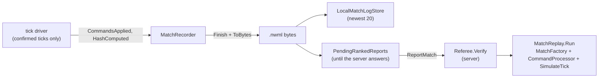

# Match log

> [!question] The question
> What is a recording of a Node War match, and how can a server that never watched the
> match prove who won from it?

**Where you are:** [[Home]] › [[Backend]] › **Match log** (system). It also belongs to [[Match]], where recording happens.

## The problem

The server needs evidence. A screenshot or a "winner = me" field proves nothing. A video
is huge and still unverifiable. The evidence has to be small, complete enough to rebuild
the whole match, readable by future builds, and impossible to make *inconsistent* without
detection.

## The idea

**Record the *inputs* (starting setup, both loadouts, draft, every confirmed command batch)
plus periodic state hashes. Anyone with the same simulation can replay it and must arrive at
the same hashes and winner.** That makes it a [[Send intent, not results]] log.

## How it works here

- **Recorder** (`MatchRecorder`): `GameManager` subscribes it to the tick driver's
  `CommandsApplied` and `HashComputed` events, for drafted matches only. **Only confirmed
  ticks** are recorded, never speculative ones ([[Netcode]]).
- **Format** (`MatchLogFormat`): a chunked binary file, see [[Match log format]].
- **Replay** (`MatchReplay.Run`): rebuilds tick 0 through `MatchFactory`, applies the
  recorded commands, simulates, and checks every checkpoint hash and the final hash.
- **Referee** (server): replay plus limits (512 KiB, a known balance hash, a known map). See [[Referee]].

## Why this, not that

| Decision | Alternative | Why the alternative lost |
|---|---|---|
| Record inputs | Record state snapshots | Inputs are tiny and replayable. Snapshots are big and can't prove how they were reached |
| Full replay on the server | Check only the hash checkpoints | A client could forge hashes. Only re-simulating proves them |
| Chunks with tags (versioned) | Reuse the live packet layout | Packets change with every protocol bump, and logs must outlive builds |
| Refuse logs from a different simulation version | Reinterpret old inputs under new rules | Old inputs under new rules give a different match. Better to say "can't verify" than to verify the wrong thing |

## What it costs later

- **Replays depend on old simulation code.** A log from simulation version 3 needs the version-3
  rules. Keeping old versions playable needs side-by-side simulation builds, which don't exist yet.
- **Logs aren't signed** (there's no SIGNATURES chunk yet), so a client can fabricate a consistent log.
- **The referee is single-file.** The simulation's static configuration forces one replay at a time per process.
- **A replay viewer** (watching old matches) is unbuilt. The data is already there.

## Traps

- **Recording speculative ticks.** They might be rolled back.
- **Changing a chunk's meaning.** Add a new tag instead ([[Numbers on the wire are forever]]).
- **Letting cosmetics (skins) affect the hash.** They're logged, but kept out of state.

## Patterns you've seen before

- 🔁 [[Send intent, not results]] · [[Same code, three places]] · [[Numbers on the wire are forever]] · [[Never trust the wire]]

## Check yourself

> [!question]- A 15-minute match is 9,000 ticks. Why is the log still small?
> Empty command ticks are omitted, and each command is 24 bytes. Most ticks have no commands,
> and hashes are only every 50 ticks.

> [!question]- What does the referee *not* prove?
> That each player actually issued their own commands. It proves the log is internally
> consistent and that the claimed result follows from it.

## Go deeper ↓

- [[Match log format]] · [[Referee]]
- Scripts: [[MatchRecorder]] · [[MatchLogFormat]] · [[MatchReplay]] · [[Referee (script)]]

Agent card: `docs/systems/match-log.md`

## My understanding

<!-- Yours. AI never edits below this line. -->
