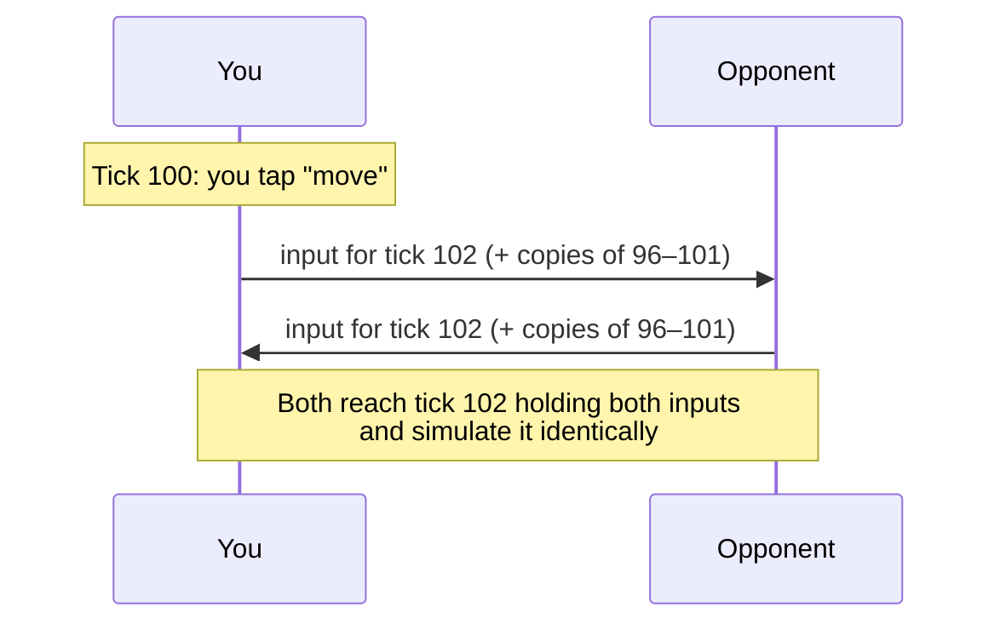
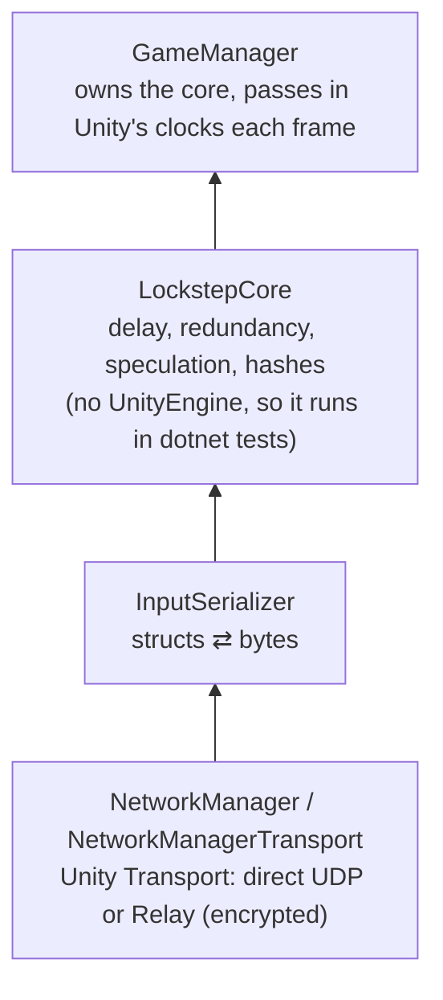

# Netcode

> [!question] The question
> Lockstep can't run tick N until it holds *both* players' commands for tick N. How do you
> get them there in time, across a network that loses and delays messages?

**Where you are:** [[Home]] › [[Match]] › **Netcode** (system)

## The problem

The internet doesn't promise anything. A message can be lost, can arrive late, or can
arrive twice. In lockstep, one missing input stops the game *on both screens*, because
neither machine may move past a tick it can't compute exactly. A naive version freezes
every time Wi-Fi hiccups.

## The idea

**Schedule your own commands slightly in the future, send each one several times, and
if the opponent goes quiet, guess what they did and correct the guess when the truth arrives.**

## How it works here

Here is one ordinary tick:

Netcode has five tools. Each has its own shell-2 note:

| Tool | What it does | In one number |
|---|---|---|
| [[Build identity handshake]] | Refuses to play against a different build | 3 values must match: protocol, simulation, content |
| [[Input delay]] | Your tap on tick 100 is scheduled for tick 102, so the packet has time to arrive | Starts at 2 ticks (200 ms) and adapts between 2 and 6 |
| [[Tick packets]] ✅ | Each input is sent seven times across seven ticks, so losing one costs nothing | 15 bytes + 24 per command |
| [[Rollback]] | After 300 ms of silence, assumes the opponent did nothing, keeps playing, and replays when the truth arrives | At most 20 ticks (2 s) of guessing |
| [[Desync detection]] | The peers compare a hash of the whole state | Every 50 ticks |

**The layers, from the network up:**

`LockstepCore` deliberately contains no Unity code. The caller passes the time in. That
is why `dotnet/NodeWar.Network.Tests` can run the whole loop over a *simulated* bad
connection (packet loss, jitter, outages) and check that the result matches a perfect one.

## Why this, not that

| Decision | Alternative | Why the alternative lost |
|---|---|---|
| Input delay of 2–6 ticks | Zero delay | Commands feel instant, but almost every packet arrives "late", so the game stutters constantly. A steady 200 ms is easier to accept than random freezes |
| Send copies ahead of any loss | Wait for an acknowledgement and resend what's missing | A resend can only start after you *notice* the loss, which takes at least one round trip. A copy is already on its way 100 ms later |
| Guess "the opponent did nothing" | Freeze until the input arrives | Freezing punishes both players for one player's hiccup. Most ticks carry no commands, so the guess is usually right |
| Copy the state once per disruption, then replay | Snapshot every tick (like GGPO) or replay from tick 0 | Snapshots cost memory and time on every tick, even when nothing goes wrong. Replaying from tick 0 grows slower as the match goes on |
| Peer to peer plus a post-match referee | A hosted server running the simulation | A hosted server costs money for every minute of every match |

## What it costs later

- **Inputs aren't signed.** The referee proves a log is *consistent*, not that each
  player really issued their own commands. A cheater could fabricate both sides' commands
  and recompute the hashes. Per-player signatures are the known fix.
- **Two-seat assumptions.** `FromPeer` gives remote commands the slot `1 - localPlayerID`,
  and player 0's commands always apply before player 1's. 2v2 needs a seat map here.
- **Every packet change has ripples.** Changing `GameCommand` means changing the
  serializer, bumping `ProtocolVersion` and adding a new match-log tag, all in one commit.
  Old builds then can't play new ones.
- **Rollback is visible.** A wrong guess can snap units back. How that should *feel* is
  still being tuned in two-player testing.

## Traps

- **Game logic in the network layer.** Netcode carries data. It never decides rules
  (`.claude/rules/network.md`).
- **Acting on the recording events.** `CommandsApplied` and `HashComputed` exist so the
  match log can record. Nothing may change the game through them.
- **Trusting the packet's own `playerID`.** The sender's slot comes from *which connection*
  delivered the packet.
- **Recording, hashing or settling a guess.** Only confirmed ticks count.

## Patterns you've seen before

- 🔁 [[Send intent, not results]]: commands cross the wire, never state.
- 🔁 [[Treat bad input as a case you already handle]]: a malformed packet is dropped as
  if lost, because the protocol already survives loss.
- 🔁 [[Never trust the wire]]: identity comes from the connection, not the contents.
- 🔁 [[Constants come from measurements]]: 6 copies, 300 ms and 20 ticks were each tuned
  by sweeping a simulated bad connection, not guessed.

## Check yourself

> [!question]- Your opponent's Wi-Fi drops for one second. Walk through what your screen does.
> For the first 300 ms you see nothing unusual: a slightly late input simply waits a frame.
> After that your game *speculates*, assuming the opponent is idle. Once the speculation
> has run 5 ticks (0.5 s) the "unstable link" banner appears. The connection returns
> about 0.7 s later, well inside the 20-tick (2 s) limit. Your machine restores the
> confirmed state, replays the missed ticks with their real inputs, and anything the
> opponent actually did in that second snaps into place.

> [!question]- Why does `LockstepCore` take the time as a parameter instead of reading `Time.time`?
> So it contains no UnityEngine code and can run in plain `dotnet test`, where a fake clock
> and a fake lossy connection can test hours of bad network in seconds, the same way every time.

> [!question]- A modded client sends commands that claim to move *your* villagers. What happens?
> Your machine overwrites each remote command's `playerID` with the sender's slot. Then
> `CommandProcessor` sees a command whose player doesn't own the villager, and ignores it.
> The cheater's machine applies the commands as written. The two states diverge, the hash check catches the desync, and the two
> logs disagree. The referee marks the match disputed instead of awarding a win.

## Go deeper ↓

- Mechanisms: [[Tick packets]] · [[Input delay]] · [[Rollback]] · [[Build identity handshake]] · [[Desync detection]]
- Scripts: [[LockstepCore]] · [[InputSerializer]] · [[InputDelayController]] · [[SetupAgreement]] · [[LocalBuildIdentity]] · [[NetworkManager]]

Sideways → [[UDP vs TCP]] · [[Deterministic lockstep]] · [[NAT and relay servers]] · agent card: `docs/systems/netcode.md`

## My understanding

<!-- Yours. AI never edits below this line. -->
