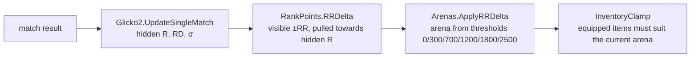

# Progression

> [!question] The question
> How does the game measure skill for fair matchmaking, while showing players a rank that
> feels rewarding, and how are unlockable items identified so they survive renames and redesigns?

**Where you are:** [[Home]] › [[Backend]] › **Progression** (system)

## The problem

Three needs pull against each other:
1. **Matchmaking needs an honest skill estimate**, including how *uncertain* it is about new players.
2. **Players need a visible rank** that moves predictably, rewards wins and doesn't swing wildly.
3. **Items need permanent identities.** Once a player owns `suit.archer.e2`, that ID must mean the same thing forever.

## The idea

**Two numbers: a hidden Glicko-2 rating (skill plus uncertainty) for matchmaking, and visible
Rank Points (RR) that drift towards the hidden rating. All the rules are pure functions in a
UnityEngine-free library, shared by server, client display and tools.**

## How it works here

| Concept | Where | Notes |
|---|---|---|
| Hidden rating | `Rating(R, RD, Sigma)`, defaults 1500 / 350 / 0.06 | RD = uncertainty. High for new players, shrinks with games |
| Visible RR | `RankPoints.RRDelta` | +/− 20 base, corrected towards hidden skill, clamped to 8–40 |
| Arenas | `RankTable.Thresholds` | Six arenas. Shared table so client and server agree |
| Catalog | `CatalogItem { Id, Kind, BaseId, Era, Retired }` | IDs never deleted or reused, only retired |
| Settlement | `MatchSettlement.Settle` | Pure: two players in, two outcomes out. No I/O, no clock |

Full detail: [[Rating and rank]].

## Why this, not that

| Decision | Alternative | Why the alternative lost |
|---|---|---|
| Glicko-2 | Elo | Elo has no notion of uncertainty, so new players take ages to place |
| Hidden rating + visible RR | Show the rating directly | Raw ratings swing and feel punishing. RR gives steady, legible progress |
| Pure library (doubles allowed) | Rules inside Cloud Code functions | Pure rules are testable and shared with the client's display. Doubles are fine because this is computed once on the server ([[Why floats break determinism]]) |
| Retire, never delete, IDs | Rename freely | A renamed ID orphans every player who owned it |

## What it costs later

- **The numbers are placeholders** ("These numbers are placeholders pending design"). Calibrating them needs real match data.
- **Two eligibility systems coexist** (generic eras and the three-node suit tree). They must be unified.
- **No currency or purchase economy yet.** Ownership is granted, not bought.

## Traps

- **Changing a threshold on one side only.** `RankTable` is shared for that reason.
- **Renaming a C# enum** that's used as a storage key. Storage keys are explicit strings (`CatalogKeys`).
- **Letting rating doubles leak into `Simulation/`.**

## Patterns you've seen before

- 🔁 [[Pure core, Unity shell]]: here it's "pure rules, server shell".
- 🔁 [[Numbers on the wire are forever]]: catalog IDs.

## Check yourself

> [!question]- A brand-new player beats a veteran. Why does their hidden rating jump much more than the veteran's drops?
> The new player's RD (uncertainty) is high, so the system updates them strongly. The veteran's
> RD is low, so one result barely moves them.

## Go deeper ↓

- [[Rating and rank]]
- Scripts: [[MatchSettlement]] · [[Glicko2]] · [[RankPoints]]

Agent card: `docs/systems/progression.md`

## My understanding

<!-- Yours. AI never edits below this line. -->
