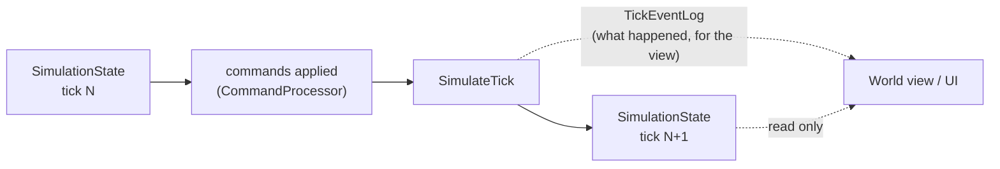

# Simulation

> [!question] The question
> What *is* a Node War match, as data, and what rules turn one tick's data into the next,
> identically, on every machine that will ever run it?

**Where you are:** [[Home]] › [[Match]] › **Simulation** (system)

## The problem

The same match is computed in four places: your machine, your opponent's, the server's
referee after the match, and the balance rig on a developer's PC. All four must produce
**bit-for-bit identical** results from the same inputs. One `float` rounding differently,
one dictionary iterated in a different order, or one rule run in a different sequence, and
they disagree. Then the match desyncs, or the referee rejects an honest result.

## The idea

**The whole match is one plain data object (`SimulationState`: arrays of nodes, villagers
and players). One static function (`SimulateTick`) advances it by exactly one tick, using
only integer maths, in a fixed order of steps, with no Unity, clocks or randomness from
outside.**

## How it works here

- **State** is plain arrays indexed by ID: `nodes[]`, `villagers[]`, `players[]`, plus
  `tickCount`, `gameOver` and `winnerID`. There are no references to Unity objects and no
  hidden caches.
- **The tick** runs its steps in a fixed order (see [[The tick]]): movement → combat →
  claiming → production → healing → respawns → win check → resume orders.
- **Events** (`TickEventLog`) report *moments* (CombatStarted, VillagerDied, NodeClaimed,
  Breach…) so the view can play effects. They are output only. No rule ever reads them, and
  they are not part of the hash.
- **Hash.** `SimulationStateHasher` reduces the whole state to one `int`. The peers compare
  hashes every 50 ticks ([[Desync detection]]), and every new state field must be added to it.
- **Rate.** 10 ticks per second. Each tick is a fixed step and never depends on frame
  time ([[Fixed timestep]]).

## Why this, not that

| Decision | Alternative | Why the alternative lost |
|---|---|---|
| Plain data plus static functions | GameObjects with MonoBehaviours running the rules | MonoBehaviours tie the rules to Unity. The server referee and the dotnet tests have no Unity, so the rules couldn't run there |
| Integer maths | `float` with careful rounding | Floats can round differently across CPUs, compilers and builds ([[Why floats break determinism]]). Integers can't |
| Arrays indexed by ID | `Dictionary<int, Villager>` | Iteration order of a Dictionary isn't something two machines are guaranteed to share. Arrays are always walked 0, 1, 2… |
| A fixed order of steps | Each system ticks itself (Unity's `Update` order) | Unity doesn't guarantee `Update` order between objects. The rules depend on it (combat before claiming changes who owns what) |
| Events separate from state | Views compare old and new state to spot changes | Some moments leave no trace in state (damage healed in the same tick). Explicit events say what happened |

## What it costs later

- **One big class.** `GameSimulation` is about 1,500 lines, and movement, ownership and
  economy are linked through step order. Splitting it means keeping that order exactly.
- **Global configuration.** Balance and path settings are `static`, so one process can't
  run two differently tuned matches at once. The balance rig runs matches one after
  another, and the referee takes a lock.
- **Every rule change is a version question.** If the same inputs would now give a
  different result, `SimulationVersion` must be bumped and the pinned test baselines
  reviewed. Old replays then need the old rules.
- **Optimisation is constrained.** Allocations per tick (for example the start-of-tick
  owner snapshot) are easy wins, but only if the order of operations stays identical.

## Traps

- `float`, `double`, `UnityEngine.Random`, `DateTime` or `Time.deltaTime` anywhere in `Simulation/`.
- **Iterating a Dictionary or HashSet.** *Holding* one is fine, *looping over* one is not.
- **Sorting without an ID tiebreaker.** Two equal items might come out in either order.
- **Adding a state field without hashing and copying it.** Desyncs go undetected and rollback silently loses data.
- **Making a rule depend on the event log.** Events are output only.

## Patterns you've seen before

- 🔁 [[Pure core, Unity shell]]: the purest example in the codebase. No `using UnityEngine` at all.
- 🔁 [[Same code, three places]]: peers, referee and rig all call this same `SimulateTick`.
- 🔁 [[Send intent, not results]]: this is the rulebook that turns intents into results.

## Check yourself

> [!question]- Why can the referee on Unity's servers run this code at all?
> Because `Simulation/` has no UnityEngine references. It compiles as plain .NET, so a
> Cloud Code module can include it and replay a match without a game engine.

> [!question]- A designer wants damage to be 1.5× on Fortresses. How do you do it without a float?
> Scale with integers: `damage * 3 / 2`, or store percentages (`damage * 150 / 100`).
> Decide the rounding direction on purpose. The codebase uses ceiling division
> `(a + b - 1) / b` when it must round up.

> [!question]- Why must `CopyFrom` restore *into* the existing state object rather than replace it?
> Views hold references to the state's arrays. Replacing the object would leave them
> drawing a dead copy after a rollback. That is the "in-place restore preserves observers'
> references" decision on the card.

## Go deeper ↓

- [[The tick]]: the canonical step order and why it matters
- [[Desync detection]]: one number that proves two states match
- Scripts: [[SimulationState]] (the data) · [[GameSimulation]] (the rules) · [[Pathfinding]] ·
  [[TickEvents]] · [[SimulationStateHasher]] · [[TickRunner]] (the local driver)

Sideways → [[Why floats break determinism]] · [[Fixed timestep]] · contract: `docs/contracts/determinism.md`

## My understanding

<!-- Yours. AI never edits below this line. -->
