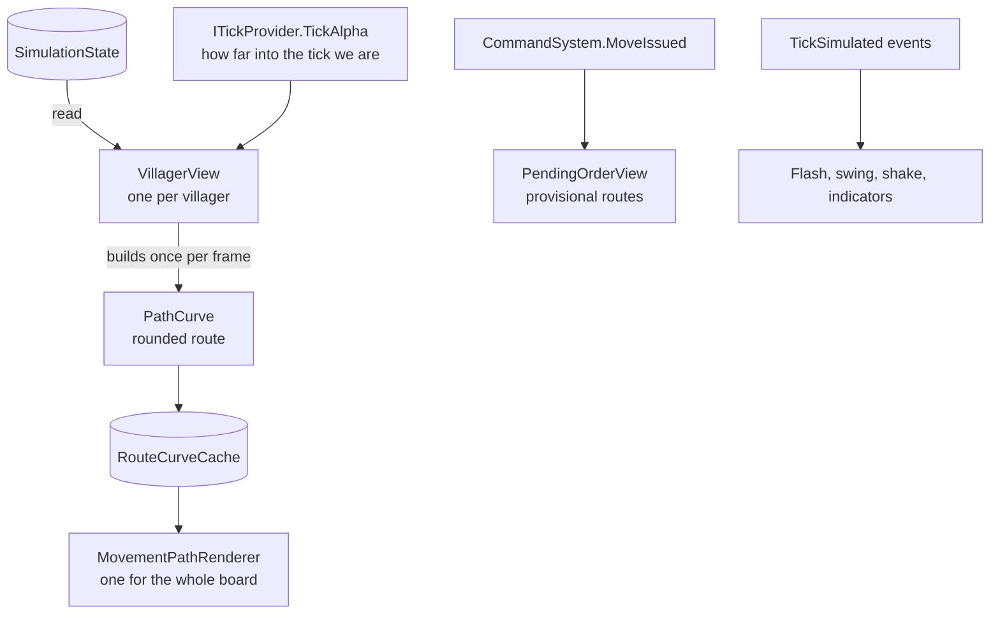

# World view

> [!question] The question
> The simulation thinks in whole ticks and node IDs, ten times a second. The screen draws
> 60+ smooth frames a second in 3D space. How does one become the other without the screen
> ever lying about the game?

**Where you are:** [[Home]] › [[Match]] › **World view** (system)

## The problem

The simulation says "villager 7 is on the leg from node 3 to node 4, 6 of 15 ticks along."
That is the truth, but it's jerky: it changes only every 100 ms, and a grid path is a
staircase of right angles. The player needs smooth movement, routes that show where units
are heading, instant feedback when they give an order, and effects when things happen.
None of that may ever feed back into the game.

## The idea

**Views read `SimulationState` and the tick events, then *add presentation*: smoothing
between ticks, rounded curves, colour, fades and feedback. They never write anything back.
All presentation maths that can be pure is pure and tested.**

## How it works here

Three mechanisms carry most of the weight:

| Mechanism | Problem it solves | Note |
|---|---|---|
| Interpolation | Ticks are 100 ms apart, frames are about 16 ms | [[Smooth movement between ticks]] |
| Rounded route lines | A staircase path reads badly, and enemy routes leak information | [[Route lines]] |
| Provisional orders | An order takes 200+ ms to reach the simulation | [[Pending orders]] |

There is much more in the system (outlines, indicators, terrain, district art, screen
shake, paint selection). Those notes come later.

## Why this, not that

| Decision | Alternative | Why the alternative lost |
|---|---|---|
| Views read state each frame | Simulation pushes updates to the views | The simulation would have to know about the views, which breaks the Unity-free boundary |
| Interpolate between ticks | Snap to each tick | Ten jumps a second looks broken |
| Interpolate *backwards* from known ticks | Extrapolate (predict ahead) | Prediction is sometimes wrong and must snap back. Interpolation is always faithful to real ticks |
| Pure maths classes (`PathCurve`, `VillagerFlashMath`…) | All logic inside MonoBehaviours | Pure classes are testable in `dotnet test` with no scene |
| Components added at runtime (outlines, rings) | Edit prefabs | Prefab and scene edits can't be checked by compile-check or code review |

## What it costs later

- **Views hold live arrays.** After a rollback or new spawns, arrays can shrink or grow,
  and every view must tolerate that. `GameManager` coordinates creating and cleaning up views.
- **Visual systems must agree.** Camera POV, sprite bounds and rollback all affect several
  views at once.
- **Some things need a device to verify:** render passes, sorting, paint coverage cost.
  Tests cover the maths, not the pixels.

## Traps

- **Writing state** "just to fix a visual", even a flag.
- **Keeping a reference to the `TickEventLog`.** It is cleared and reused every tick, so copy what you need.
- **Building a second copy of the route curve.** Sprite and line must use the *same* geometry, or units walk beside their own lines.
- **`Time.deltaTime` in the simulation.** It's fine here, because floats and frame time are allowed on this side of the boundary.

## Patterns you've seen before

- 🔁 [[Presentation reads, never writes]]: this system is the pattern's home.
- 🔁 [[Pure core, Unity shell]]: `PathCurve`, `PendingOrderTracker` and `*Math` classes.
- 🔁 [[Events and observers]]: views subscribe to `TickSimulated` and `MoveIssued`.

## Check yourself

> [!question]- A frame runs three ticks at once (the game is catching up). How many times does `TickSimulated` fire, and why does it matter?
> Three times, once per tick, inside the runner's loop. A view that only looked at the
> latest state would miss a death that happened on the first of those three ticks.

> [!question]- Why does the opponent's route get *cut short* instead of just faded out?
> Fading still sends the full route to the screen. Anyone who turns up their brightness
> sees where the enemy is going. Truncating the geometry means the information isn't
> drawn at all.

## Go deeper ↓

- [[Smooth movement between ticks]] · [[Route lines]] · [[Pending orders]]
- Scripts: [[VillagerView]] · [[PathCurve]] · [[RouteCurveCache]] · [[MovementPathRenderer]] ·
  [[OrderPresentation]] · [[PendingOrderView]] · [[PendingOrderTracker]]

Agent card: `docs/systems/world-view.md`

## My understanding

<!-- Yours. AI never edits below this line. -->
