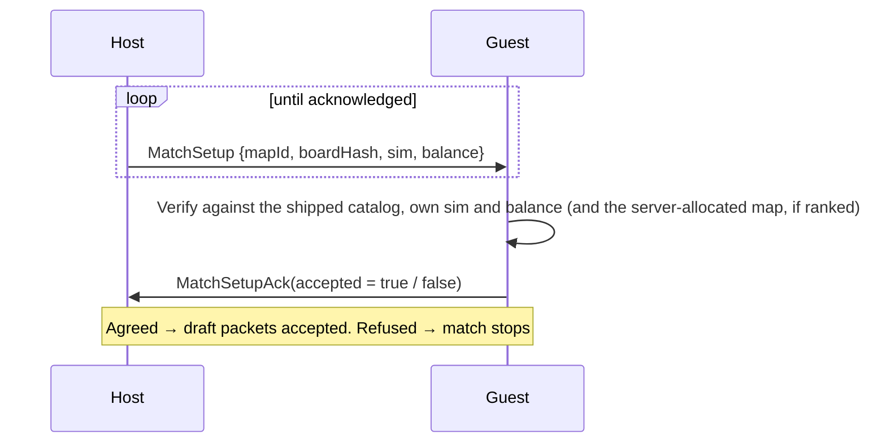

# Build identity handshake

> [!question] The question
> You updated the game and your friend didn't. Lockstep needs *identical* rules on both
> machines. How do the two builds find out they can't play together, before anything goes wrong?

**Where you are:** [[Home]] › [[Match]] › [[Netcode]] › **Build identity handshake** (mechanism)

## The problem

Three different things can differ between two builds, and each breaks lockstep in its own way:
1. **The wire format.** They can't even read each other's packets.
2. **The simulation rules.** The same commands give different results, so they desync.
3. **The balance data.** The same code with different numbers also desyncs.

Then, before the draft, they also have to agree on *which map* they're playing.

## The idea

**Two gates. First, a *handshake* swaps a 9-byte build identity `{protocol, sim, content}`, and
any mismatch refuses the connection. Second, a *setup agreement* has the host propose
`{map, board hash, sim, balance}`, and the guest checks it against its own shipped catalog.
No draft packet is honoured until both agree.**

## How it works here

**Gate 1, handshake** (`InputSerializer.SerializeHandshake` / `Compare`):

```
[type:1][protocol:2][sim:2][content:4]   = 9 bytes, both directions
Compare: protocol differs → PeerOlder / PeerNewer
         sim differs      → PeerOlder / PeerNewer
         content differs  → ContentMismatch
         all equal        → Compatible
```

`LocalBuildIdentity.Current` builds this build's identity: `ProtocolVersion.Current` (6),
`SimulationVersion.Current`, and `BalanceHasher.Hash` of the shared balance asset. Bytes 0–2 never
change meaning, so even a far-future build can tell which protocol a peer speaks.

**Gate 2, setup agreement** (`SetupAgreement`, a small state machine):



A repeat of the agreed setup gets the same answer (lost acks are safe). A *different* setup after agreement is refused as a conflict.

**The server does the same check.** Ranked tickets carry `{protocol, sim, content}`, and
Matchmaker only pairs equal builds. The match record pins the map.

## Why this, not that

| Option | Gain | Pay | Verdict |
|---|---|---|---|
| **Refuse mismatched builds** (chosen) | Simple and safe | Players on different versions can't play | Chosen. Expected for lockstep games |
| Translate commands between versions | Cross-version play | A translation layer per version pair, and the simulations still differ | Impossible for different *rules* |
| Download the missing content at match start | Fixes balance-only mismatches | Hot content delivery and integrity checks | A possible future for balance only |

## Check yourself

> [!question]- Same code, but one player's balance asset changed one number. Which gate catches it?
> Gate 1: the `content` hash differs, so the verdict is `ContentMismatch`. (Gate 2 would also catch it through `BalanceHash`.)

> [!question]- Why does the guest check the map against its *own* catalog rather than trusting the host's board hash?
> The host could propose any board. The guest can only play boards it ships, and the hash
> proves they mean the same board.

## Go deeper ↓

- [[LocalBuildIdentity]] · [[SetupAgreement]] · [[InputSerializer]]

## My understanding

<!-- Yours. AI never edits below this line. -->
