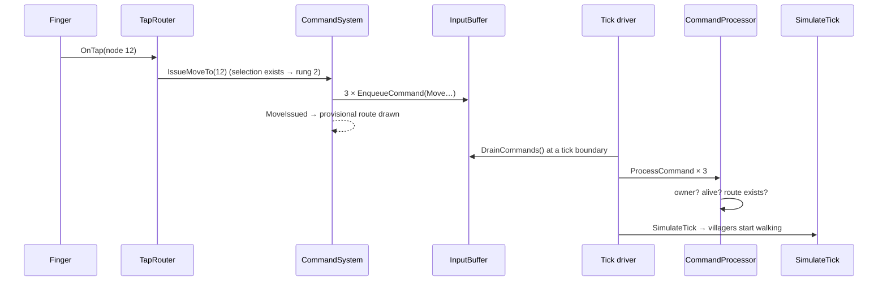

# Command pipeline

> [!question] The question
> Follow one order, "these three villagers, go to that node", from your finger to the moment
> the villagers start walking. Where does it wait, and why?

**Where you are:** [[Home]] › [[Match]] › [[Commands]] › **Command pipeline** (mechanism)

## The problem

The order has to reach the simulation on *both* machines, at the *same* tick, in the
*same* order relative to everything else, and still be valid when it gets there. It also
has to feel responsive to the person who gave it.

## The idea

**Build the command once, queue it, let a tick driver collect the queue at a tick
boundary, and validate it again at the moment of applying it. Responsiveness is handled
separately, by drawing a preview.**

## How it works here

### The journey, step by step

1. **`TapRouter`** decides the tap is a move order, because villagers are selected and a node was tapped.
2. **`CommandSystem.IssueMoveTo`** builds **one Move per villager**, each stamped with
   `issuedOnTick = state.tickCount`. It's "the only place a Move command is built": right-click
   and touch both end up here. It raises `MoveIssued` and then clears the selection.
3. **`InputBuffer`** is just a `List<GameCommand>`. No logic, no reordering.
4. **A tick driver** drains it. There are two drivers, and both implement `ITickProvider`:
   - **`TickRunner`** (local and bot matches) drains every tick and applies immediately.
   - **`LockstepCore`** (online) drains into the input for tick *now + delay*, sends it
     ([[Tick packets]]), and when that tick comes applies **all of player 0's commands, then all of player 1's**.
5. **`CommandProcessor.ProcessCommand`** validates and applies the command. For a Move:
   valid player? valid villager? *owned by that player?* not dead or consumed? valid
   destination? Any "no" means it **silently does nothing**.
6. **`SimulateTick`** runs, and movement advances.

### The latency budget, online

| Step | Adds | Why |
|---|---|---|
| Node tap waits to see if a double/triple tap follows | up to 0.22 s | Node double/triple tap is on by default ([[Gesture recognition]]) |
| Waiting for the next input to be generated | 0–0.1 s | Inputs are generated once per tick |
| Input delay | 0.2 s (2 ticks) at the start, adapting from 2 to 6 ticks | Gives the packet time to reach the opponent ([[Netcode]]) |
| **Total, tap to first step** | **about 0.3–0.5 s** | |

That is why [[Pending orders]] exists: the *acknowledgement* is instant even though the *effect* isn't.
Right-click on desktop skips the tap-chain wait.

## Why this, not that

| Decision | Alternative | Why the alternative lost |
|---|---|---|
| One Move per villager | One "move group" command listing many IDs | Fixed-size commands keep the wire and log formats simple. The cost is 24 bytes × N, which is fine up to 25 villagers |
| Silent refusal | Return an error to the UI | The UI is ticks behind and on a different machine. There's no one to tell, and a refusal has to be deterministic on both sides anyway |
| Player 0's commands, then player 1's | Interleave by arrival time | Arrival time differs between the two machines. Seat order is the same everywhere |
| Two drivers, one interface | `if (online)` checks throughout the code | Views and recording subscribe to `ITickProvider` and never need to know which driver is running |

## What it costs later

- **2v2 needs a seat order** that generalises "P0 before P1".
- **Silent refusals are invisible.** A player who orders the impossible sees the
  provisional line just fade out after 1.5 s. Explaining *why* would need a refusal reason
  that doesn't affect determinism.
- **In local play the recorded order of commands mixes both players**, which is why the match
  log records the order of application rather than one list per player.

## Traps

- **Treating `MoveIssued` as confirmation.** It's an acknowledgement of *intent*.
- **Building a Move anywhere but `IssueMoveTo`.** You'd lose the highlight, the preview and the single-place guarantee.
- **Calling `CommandProcessor` from UI.** Only drivers call it (`.claude/rules/view-ui.md`).

## Patterns you've seen before

- 🔁 [[Presentation reads, never writes]]: the buffer is the one way in.
- 🔁 [[Never trust the wire]]: the processor rechecks even your own commands.
- 🔁 [[Hide latency with honest previews]]: `MoveIssued` exists to feed one.

## Check yourself

> [!question]- You select 3 villagers and tap a node. How many bytes does that add to your next tick packet?
> 3 Move commands × 24 bytes = 72 bytes, on top of the 15-byte header.

> [!question]- Both players send a villager to the same empty node on the same tick. Whose command is applied first, and does it matter?
> Player 0's, on both machines. It can matter (whoever arrives or paths first). What matters
> more is that both machines agree, and seat order guarantees that.

> [!question]- Why does `IssueMoveTo` copy the selected IDs into a new list before raising `MoveIssued`?
> Because it clears the selection straight afterwards. Subscribers that keep the list would
> otherwise find it empty. This is a classic shared-mutable-list bug.

## Go deeper ↓

- [[CommandProcessor]]: the validator
- [[TickRunner]]: the local driver (the simplest place to see a tick loop)

## My understanding

<!-- Yours. AI never edits below this line. -->
