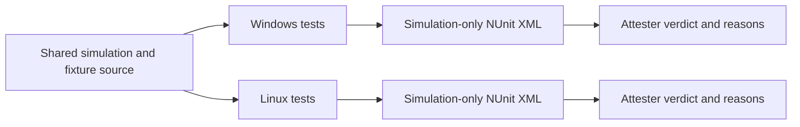

# Determinism receipts

> [!question] The question
> What turns “the simulation tests passed” into evidence that the expected fingerprints ran against the code under review?

**Where you are:** [[Home]] › [[Tooling]] › **Determinism receipts** (mechanism)

## The problem

Run the same wrong implementation twice and it can agree with itself perfectly. The baseline tests explain: in-process equality “only prove[s] that two runs in ONE build agree.” A test filter can omit the important cases; an old result file can predate an edit. A green label alone answers none of those problems.

## The idea

**Pin exact outputs for named scenarios, write a receipt from the simulation project alone, and check both case presence and freshness before trusting it.**

## How it works here

The current sanctioned fingerprints are constants in `DeterminismBaselineTests`:

| Fixture | Ticks | Expected hash |
|---|---|---|
| `EmptyTick_100Iterations_ProducesDeterministicHash` | 100 | `2084609368` |
| `MoveAndCombat_ProducesDeterministicHash` | 4 | `-1780012649` |

Each builds independent states, compares their results, then checks the pinned integer. `SimVersion_MatchesPinnedBaselines` separately checks pinned version 4 against `SimulationVersion.Current`. These tiny fixtures do not cover every rule.

CI first runs the Release solution for pass/fail. It then runs only `NodeWar.Simulation.Tests` with an absolute NUnit `LogFilePath` pointing at the repository's `TestResults/results.xml`. Sending every project's logger to that same file would let the last writer overwrite the simulation receipt.

The attester checks for a `<test-run>` root and both required fingerprint case names with `Passed` results. It compares the receipt's file timestamp against the last Simulation commit and the newest `.cs` file under Simulation and the shared EditMode test directory. It reports the current commit. Missing receipt returns 2; failure returns 1; PASS returns 0. It does not require the simulation-version case itself; the full suite checks that.

The workflow uses full git history, keeps the other OS leg running after a failure, and uploads each leg's receipt even on failure. Both legs assert the same pins; there is no separate job comparing XML files byte for byte.

## Why this, not that

| Decision | Alternative | Gain | Cost |
|---|---|---|---|
| Exact stored fingerprints | Only compare two fresh runs | Detect unintended output changes across code revisions | Deliberate changes require explained repins |
| Required case names in the receipt | Trust an overall green result | Detect omissions and skips of those cases | Renaming fixtures requires coordinated changes |
| Check source timestamps | Accept any old XML | Catch receipts older than watched edits | Timestamp evidence is limited, not a content digest |
| Windows and Linux | One local runtime | Test a real platform boundary | Still a sample of platforms and scenarios |

## What it costs later

A changed pin needs an explanation. The computation document requires deliberate repins to travel with the change, the hash constants and version coordination. Platform disagreement must be investigated, never papered over by a new pin. Hash-schema changes can move fingerprints even when a fixture's visible gameplay is unchanged; the test comments explain that for the current pins.

## Traps

- The attester is not a whole-suite validator. Its required-case checks are narrower than “every test passed.”
- If commit dating is unavailable/unparseable, or no watched sources are found, the corresponding freshness check is skipped rather than failed closed. Read the reasons.
- Timestamp freshness does not prove every dependency was rebuilt. Unwatched code and stale live-Editor assemblies remain concerns.
- [[Desync detection]] compares peers during a match. Baselines compare known scenarios against recorded expectations before shipping. They use related hashing for different questions.

## Patterns you've seen before

- 🔁 [[Same code, three places]]: shared source makes cross-runner results comparable.
- 🔁 [[Never trust the wire]]: the analogous move is to inspect required receipt contents before accepting the claim.
- 🔁 [[Constants come from measurements]]: pins are recorded outcomes to explain and reproduce, not numbers to guess.

## Check yourself

> [!question]- All selected tests passed, but the receipt contains neither fingerprint case. Is the gate satisfied?
> No. The attester rejects omitted required cases even if the selected run was green.

> [!question]- Why does the workflow disable matrix fail-fast?
> A failure on one OS and success on the other is valuable determinism evidence. Cancelling the other leg would hide it.

## Go deeper ↓

- [[SimulationStateHasher]] · [[sim-guard.ps1]]
- Read `DeterminismBaselineTests.cs`, then `docs/attesters/hash_baseline.ps1` from the sources above.

Sideways → [[Desync detection]] · [[Test evidence]] · [[Why floats break determinism]]

## My understanding

<!-- Yours. AI never edits below this line. -->
