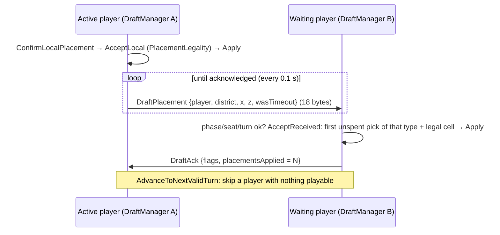

# Draft turns

> [!question] The question
> One placement, start to finish: what's validated where, what goes on the wire, and what if the packet is lost or the turn timer runs out?

**Where you are:** [[Home]] › [[Lobby]] › [[Draft]] › **Draft turns** (mechanism)

## The problem

The draft runs over unreliable UDP *without* lockstep's redundancy, it's turn-based (one side waits on the other), and it must end with two byte-identical placement lists.

## The idea

**Each step is validated twice (sender and receiver) by the same pure rule; every packet is retained and resent until acknowledged; acknowledgements are cumulative; anything chosen automatically (timeouts, bots) uses deterministic choices from shared state.**

## How it works here

- **Phases:** WaitingForReady → InitialReveal → ActiveDraft → Complete.
- **Before any of this:** `SetupAgreement` must agree the map ([[Build identity handshake]]); until then draft packets are ignored.
- **Loadouts are exchanged** (`DraftLoadout`: length-prefixed UTF-8 IDs, era tables, skins) so each side knows the opponent's pool.
- **Repeat packets are no-ops** on receipt.
- **Timeout:** the parked piece if still legal; else the lowest playable pick at `FindRandomLegalCell(turnNumber × 7919 + playerID × 31)`, a small linear congruential generator `((seed × 1103515245 + 12345) & 0x7FFFFFFF) % count` over the legal cells. Consecutive timeouts can trigger a disconnect in networked human matches.
- **Handoff:** the manager stops polling the shared inbound queue *before* the gameplay driver takes over, so it can't swallow tick packets.

## Check yourself

> [!question]- The `DraftAck` says "placementsApplied = 5". Why is a count better than "I got packet #5"?
> It's cumulative: any later ack covers everything an earlier lost ack did. The sender stops resending everything up to 5 the moment any ack arrives.

> [!question]- Why is `((seed × 1103515245 + 12345) & 0x7FFFFFFF) % count` safe across machines?
> It's pure integer arithmetic on a seed derived from replicated state. The `& 0x7FFFFFFF` clears the sign bit so `%` never sees a negative number.

## Go deeper ↓

- [[DraftState]] · [[DraftManager]] · [[DraftSerializer]]

## My understanding

<!-- Yours. AI never edits below this line. -->
