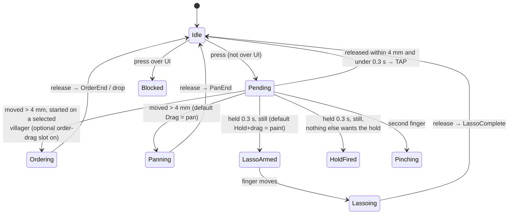

# Gesture recognition

> [!question] The question
> At the instant your finger lands, the game can't know what you mean yet. How does it wait
> just long enough to find out, and then commit?

**Where you are:** [[Home]] › [[Match]] › [[Input]] › **Gesture recognition** (mechanism)

## The problem

A press might become a tap, a hold, a pan, a lasso, an order-drag or the first half of a
double tap. You can only tell by watching *what happens next*: how far the finger moves,
how long it stays, whether a second finger arrives. Decide too early and you're wrong.
Decide too late and the game feels sluggish.

## The idea

**A [[State machines|state machine]]: every press starts *Pending*, and the first threshold
it crosses (distance, time, second finger, release) moves it to exactly one committed
state. Thresholds are physical: millimetres and seconds.**

## How it works here

The numbers (defaults, mostly configurable in Controls):

| Threshold | Value | Meaning |
|---|---|---|
| Tap slop | 4 mm | Move more than this and it's not a tap |
| Hold time | 0.3 s (0.15–1 configurable) | Stay this long and it's a hold |
| Hold stillness | 1.5 mm of *total* path | Drifting away and back still counts as moving |
| Double tap | within 0.3 s and 8 mm | Second press must land close and soon |
| Node tap chain gap | 0.22 s | How long a node tap waits for a 2nd/3rd tap |

### Two subtle rules worth noticing

- **The target is decided on press.** What's under the finger (villager, selected villager,
  node, nothing) is resolved *once*, when the finger lands. A drag that starts on an
  *unselected* villager is a pan and never selects it.
- **Node taps are deferred; ground and villager taps are not.** A tap on ground fires
  immediately, and if a second tap follows, the double tap *overrides* the first. That's safe
  because "clear" or "select" is easy to overwrite. A node tap can be an **order**, which
  can't be taken back once sent, so it waits 0.22 s to see whether this is a double or
  triple tap before deciding.

## Why this, not that

| Decision | Alternative | Why the alternative lost |
|---|---|---|
| Explicit state machine | A pile of `if` flags in `Update` | Flags combine into impossible states ("panning *and* lassoing"). One `State` field can't |
| Millimetres | Pixels | Pixel thresholds behave differently on every screen density |
| Total path length for stillness | Distance from the start point | A wobble that returns to the start would wrongly count as "still" |
| Defer only node taps | Defer every tap | Every selection tap would feel 0.22 s laggy for no benefit |

## What it costs later

- **The 0.22 s wait sits on the critical path for orders** (see the latency budget in
  [[Command pipeline]]). Turning off node double/triple tap removes it, which is a
  trade-off between features and feel.
- **Many configurable slots multiply the states.** Each new binding option needs synthetic-trace
  tests for every combination it can create.
- **Device evidence is still needed.** The numbers feel right in tests, but real thumbs on real
  phones are the final judge.

## Traps

- **Firing an order on a press.** Orders fire on release or on drop, never on touch-down.
- **Forgetting cancellation.** Any change (UI appears, bindings change, a third finger)
  must abandon the pending chain *without* issuing an order.
- **Adding a threshold in pixels.**

## Patterns you've seen before

- 🔁 [[Pure core, Unity shell]]: the classifier receives time in each sample and never
  reads a clock, so a test can replay "press, wait 0.31 s, release" exactly.
- 🔁 [[Hide latency with honest previews]]: order-drag draws the provisional route
  *while the finger is still down*.

## Check yourself

> [!question]- You press, wobble 3 mm left, 3 mm right, and release after 0.2 s. Tap or not?
> Tap. The distance *from the start* never exceeded 4 mm, and the time is under 0.3 s.
> (Path length matters only for *hold* stillness.)

> [!question]- Why does the classifier take `IReadOnlyList<PointerSample>` per frame instead of one sample at a time?
> Pinch has priority over a single-finger transition. With both fingers' samples in one
> batch, the classifier can see "a second finger arrived" before it commits the first finger to a pan.

> [!question]- Why does a node tap wait for a possible double tap, while a ground tap doesn't?
> The first tap on ground (clear) can safely be overwritten by a double tap. A first tap on
> a node may be a move order, and an order sent to the opponent can't be unsent.

## Go deeper ↓

- [[GestureClassifier]]: the script

## My understanding

<!-- Yours. AI never edits below this line. -->
