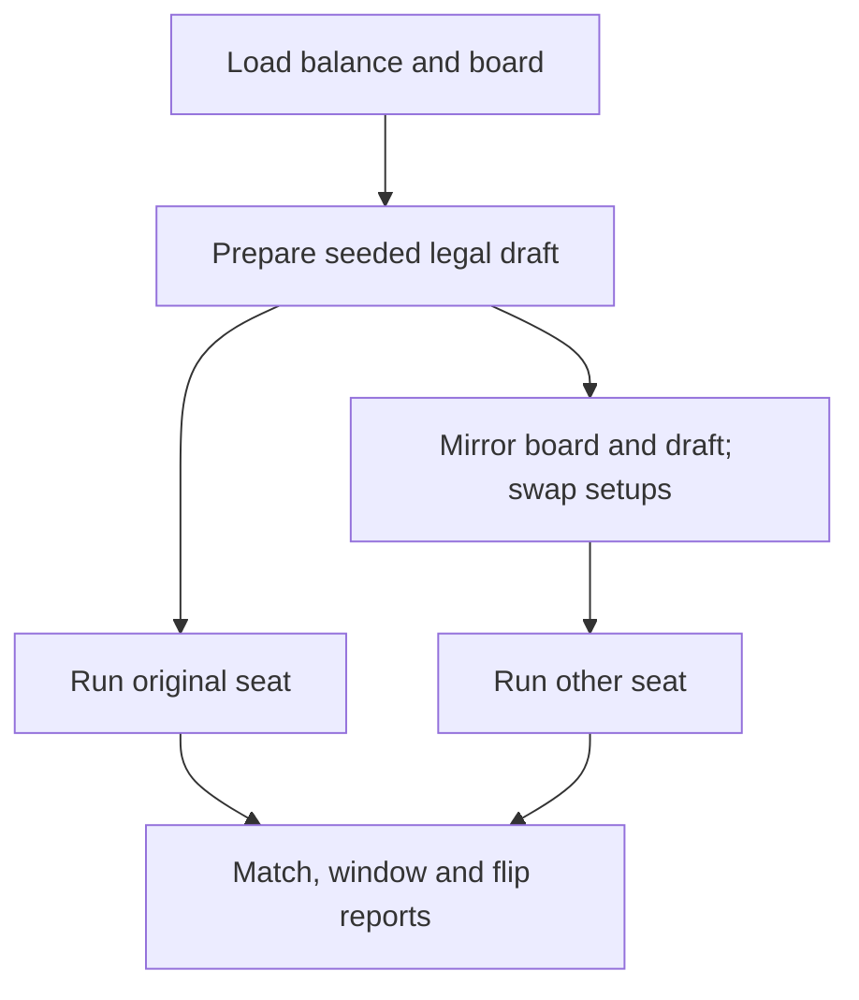

# Headless balance matches

> [!question] The question
> How do you turn bot matches into repeatable evidence without mistaking a policy weakness or a seat advantage for balance?

**Where you are:** [[Home]] › [[Match]] › [[Bots]] › **Headless balance matches** (mechanism)

## The problem

Watching one match mixes tuning, draft luck, seat effects and bot decisions. A rig needs controlled inputs and precise measurements. A win percentage without capped games or its denominator can tell a misleading story.

## The idea

**Prepare one seeded draft, play it from both seats through the real command/tick path, and measure without feeding observations back into the simulation.**

## How it works here



The console entry point is `Program.Main`; the lifecycle is [[MatchRunner]]. A normal invocation from the repository root is:

```powershell
dotnet run --project dotnet/NodeWar.BalanceRig -- --matches 100 --seed 1 --cap 6000 --out out/rig.csv
```

The rig also creates `rig.windows.csv` and `rig.flips.csv` beside the requested file.

`--matches` counts seeds. Seat swapping defaults on, so this requests 200 matches. `Prepare` uses a seeded `Random` for legal pre-match placements. The second match mirrors that same draft; it does not roll another. The shipped hourglass map uses top-to-bottom reflection; explicit board files use the loader's half-turn default.

Each loop evaluates both bots, drains commands, applies due inputs P0 then P1 preserving each player's issue order, then calls `SimulateTick`. Default delay is 0, matching the live bot path. Optional delay holds commands for later application. Game-over ends a run; reaching the cap without game-over records a capped outcome with no winner.

| Measurement | Exact meaning |
|---|---|
| Command windows | 10 seconds of ticks, grouped by application tick; refused records still count |
| Idle body-ticks | Sum of unconsumed Idle bodies across post-tick samples; minions excluded |
| Flips | Complete ownership changes, including neutralisation |
| Opening contest | Non-Core CombatStarted in the first 60 seconds |
| Lead | P0 minus P1 non-Core ownership at 120 seconds |
| Snowball | Whether that leader wins, excluding ties, capped/no-winner runs and runs ending before measurement |

At 10 Hz, those last two times are 600 and 1200 ticks. The observer derives the timing from the supplied tick rate. Report rows carry schema and starting-board identity. Console output prints source and effective balance hashes separately when an overlay changes tuning.

## Why this, not that

| Choice | Gain | Cost |
|---|---|---|
| Same source and match factory | Evidence concerns the shipped rules and bot | Shared static configuration requires sequential runs |
| Paired drafts across seats | Makes seat effects visible with comparable randomness | Twice the runs; equal outcomes are not guaranteed |
| Read-only observers | Diagnostics add no simulation state | Read-only use is a caller contract, not an immutable API |
| Keep capped/excluded outcomes visible | Honest denominators | A single headline percentage is less convenient |
| Judge live play only by these results | Cheap comparisons | Misses controls, feel and strategies this bot never attempts |

## What it costs later

Comparisons need the same seeds, map, loadout, delay and cap, plus retained balance hashes. A change to the policy changes what the experiment measures. New metrics need a definition before a CSV column: what time is sampled, which units count, and which matches are excluded?

`LoadBalance` checks a hash when the filename parses as a signed integer. A nonnumeric filename skips that comparison. This is narrower than saying every filename is enforced as a content address.

## Traps

- Declaring the side with a larger final army the winner of a capped match.
- Assuming paired matches must have equal results; ID tiebreaks can favour a seat.
- Interpreting command counts as successful actions.
- Treating a win-rate change as proof of optimal play or player enjoyment.

## Patterns you've seen before

- 🔁 [[Same code, three places]]: the rig links live bot source and runs the shared simulation.
- 🔁 [[Constants come from measurements]]: the rig supplies evidence to test tuning hypotheses; it does not prove the existing constants were measured.
- 🔁 [[Presentation reads, never writes]]: the observer has the same responsibility as a view.

## Check yourself

> [!question]- A delayed command is issued at tick 98 and applies at 100. Which window counts it?
> The window containing applied tick 100. The post-tick 101 sample also belongs to that applied tick's window.

> [!question]- There are no eligible snowball samples. Is the score zero percent?
> No. The report prints n/a and the exclusions. Zero percent would falsely imply there were predictions and every one failed.

## Go deeper ↓

- [[MatchRunner]]: preparation, mirroring, delay and stopping
- [[BotPlayer]]: the policy whose performance is being measured

Sideways → [[The tick]] · [[MatchFactory]] · [[TickEvents]]

## My understanding

<!-- Yours. AI never edits below this line. -->
