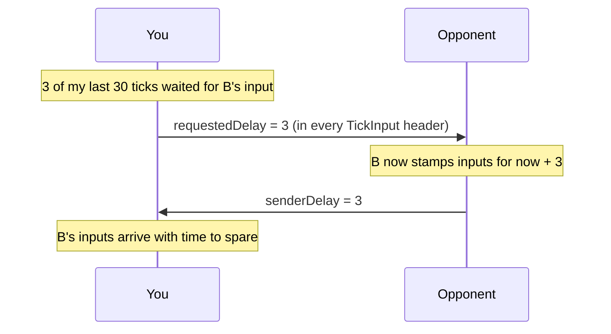

# Input delay

> [!question] The question
> Your command is scheduled 2 ticks into the future. Why 2, and how does the game decide
> to make it 3, or 6, when your opponent's connection gets worse?

**Where you are:** [[Home]] › [[Match]] › [[Netcode]] › **Input delay** (mechanism)

## The problem

In lockstep, tick N can't run until both players' inputs for N have arrived. If you stamp
your tap for the *current* tick, it can't possibly reach the opponent in time, so every tick
stalls. Stamp it far ahead, and nothing stalls, but every order feels sluggish. The right
amount depends on the connection, which changes during a match and differs in each direction.

## The idea

**Stamp each input for `now + delay`. Start at 2 ticks (200 ms). Each side watches how often
*it* has to wait for the *peer's* input, and asks the peer to raise or lower *their* delay.
Raise quickly, lower slowly.**

## How it works here

The rules in `InputDelayController`:

| Rule | Value | Why |
|---|---|---|
| Range | 2–6 ticks (200–600 ms) | Above 600 ms, commands "feel broken however bad the link" |
| Raise when | 3 late ticks out of the last 30 | "One is jitter and two can be a bad frame; three is a pattern" |
| Lower when | 200 calm ticks (20 s) with at least 0.14 s of slack every tick | Lowering too early just causes stalls again |
| Cooldowns | 1.5 s after raising, 10 s after lowering | The peer needs a round trip to act, and late ticks already in flight would trigger it again |
| Ignore | Ticks during speculation, holds, catch-up, or a silent peer | Those are outages, not a slow link |

**Why each side asks the *other*:** you can't see how long *your* packets take to arrive.
You *can* see whether the peer's packets arrive late. So you tell the peer to stamp further
ahead. There's no round-trip measurement and no clock synchronisation to get wrong.

**A safety detail:** a request outside 2–6 is *ignored*, not clamped, so a hostile peer can't
push your delay anywhere an honest peer couldn't ask for.

## Why this, not that

| Option | Gain | Pay | Verdict |
|---|---|---|---|
| **Adaptive, peer-requested** (chosen) | Each direction gets what it needs. No clock sync | More moving parts, and it needs sweep tests to tune | Chosen |
| A fixed delay (e.g. always 3) | Simple | Too slow on good links, stalls on bad ones | Started here; replaced |
| Measure round-trip time and compute the delay | Principled | Needs clock-offset estimation, and one-way latency isn't symmetric | More fragile |
| No delay plus constant rollback (fighting-game style) | Instant feel | Rewinds and re-simulates constantly, which is costly with many units | Not for an RTS |

## Check yourself

> [!question]- The delay rises from 2 to 4 in one step's worth of requests. What must happen so the peer never waits on a tick that will never come?
> Raising by k leaves k extra ticks due immediately. `GenerateLocalInputIfDue` is a *loop*,
> so it generates an input (empty after the first) for each of them right away.

> [!question]- Why are disturbed ticks ignored rather than counted as late?
> During an outage, *everything* is late. Training the delay on that would ratchet it to 6
> after every hiccup and keep it there for at least 20 s.

## Go deeper ↓

- [[InputDelayController]] · [[LockstepCore]]

## My understanding

<!-- Yours. AI never edits below this line. -->
