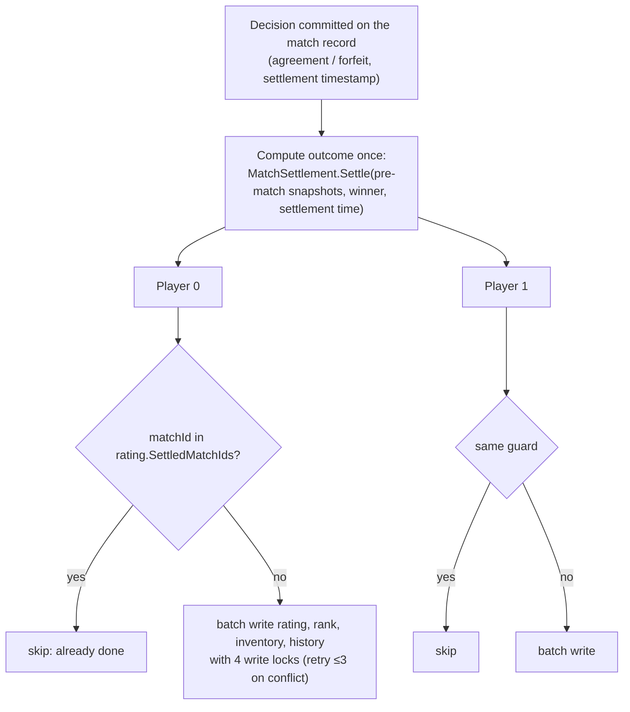

# Match settlement

> [!question] The question
> The winner is decided. Now two players' ratings, ranks, inventories and histories must
> change, with no transaction covering both players, on a server that can crash mid-way. How
> do you make sure each player is updated exactly once?

**Where you are:** [[Home]] › [[Backend]] › [[Cloud]] › **Match settlement** (mechanism)

## The problem

"Exactly once" is hard. Things that can go wrong:
- Both players' report calls try to settle at the same time.
- The function writes player 0, then times out before player 1.
- The client retries `ReportMatch` because it never saw the response.
- Between the match and settlement, a player's rating changed (another match settled).

## The idea

**Decide once, from frozen inputs; commit the decision to the match record; then apply it
to each player with a per-player [[Idempotency|idempotency]] guard, so any call can safely
redo the whole thing and only the missing parts take effect.**

## How it works here

The ingredients:

| Ingredient | Why |
|---|---|
| **Pre-match snapshots** (taken at allocation) | The outcome is computed from the ratings *as they were when the match started*. It's identical on every retry, whatever happened since |
| **Settlement timestamp stored on the record** | "Now" is frozen too, so a retry computes the same decay |
| **`SettledMatchIds` (last 200) on the `rating` key** | The idempotency guard. It's in the *same batch* as the change, so "changed" and "marked done" are atomic |
| **Committed decisions finish** | Once agreement or a forfeit is written, settlement completes even if claims expired since |
| **Uncommitted decisions re-check claims** | If the player's `activeMatch` no longer matches, return false and void instead of settling |

Why the guard isn't the history list: history keeps 20. *"A player who plays enough matches
to evict this one from history must still not be settled twice for it."* So it's a separate
200-entry list.

## Why this, not that

| Option | Gain | Pay | Verdict |
|---|---|---|---|
| **Idempotent per-player apply** (chosen) | Safe to retry from anywhere, no coordinator needed | Bounded guard lists, and careful ordering | Chosen |
| Distributed transaction across both players | True atomicity | Not offered by Cloud Save | Not possible here |
| A settlement queue / single worker | Serialises everything | Needs infrastructure UGS doesn't provide here | Not needed at this scale |
| Recompute from live ratings at settlement | Simpler inputs | Retries could compute different results | Rejected: snapshots make it deterministic |

## What it costs later

- **The guard is bounded.** A match older than 200 settlements could in theory settle again, but the match record's terminal state stops that path first.
- **There's a window where one player is settled and the other isn't.** The end card waits on `GetMatchResult`.
- **Account deletion during settlement** isn't handled yet.

## Check yourself

> [!question]- Why put `SettledMatchIds` on the `rating` key, not in a separate key?
> So the guard and the change are written in the *same atomic batch*. With separate keys, a
> crash between them could mark a match settled without changing the rating, or the reverse.

> [!question]- Could player 1 settle *another* match between this match's end and its settlement? Why does that matter?
> Normally no. A player holds one unexpired `activeMatch` claim, and it's released only after
> this match reaches a terminal state, so they can't enter another ranked match until then. That
> matters because settlement *overwrites* `rating` and `rank` with values computed from this
> match's pre-match snapshot. If another match had settled in between, its effect would be lost.
> The one-claim rule is what makes the snapshot safe to apply. (Look at `MatchSettler`:
> `state.Rating = new RatingRecord { R = settled.Rating.R, … }`.)

## Go deeper ↓

- [[MatchSettler]]: the script

## My understanding

<!-- Yours. AI never edits below this line. -->
