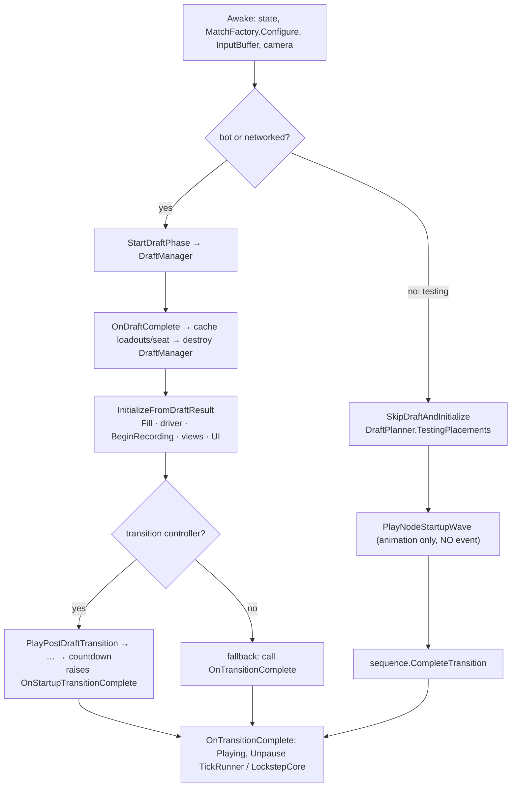

# Match startup sequence

> [!question] The question
> From the Gameplay scene loading to the first tick, which steps happen in which order, and what guarantees the game actually *starts* ticking at the end?

**Where you are:** [[Home]] › [[Lobby]] › [[Match flow]] › **Match startup sequence** (mechanism)

## The problem

Startup has several entry paths (drafted bot or online match, drafted match without a transition controller, skip-draft testing) and asynchronous animation (DOTween) in the middle. The tick driver must stay paused through the transition and countdown, then unpause *exactly once*. Miss the unpause on one path and the match freezes: commands queue up and are never drained.

## The idea

**A UnityEngine-free `MatchStartupSequence`, composed by `GameManager`: PreDraft → Drafting → PostDraft → Countdown → Playing. `CompleteTransition` unpauses the driver once. In the skip-draft path, Phase becomes Playing before initialization, but the driver stays paused until initialization and the optional wave call return.**

## How it works here

The skip-draft path is the trap: `PlayNodeStartupWave` deliberately raises no completion event. `SkipDraftAndInitialize` invokes initialization and the optional wave, then calls `CompleteTransition` itself. The drafted path waits for the controller event, or completes immediately when no controller exists.

Eight dotnet tests exercise draft transition/fallback, skip-draft with/without the wave, paused phases and duplicate completion. Successful paths advance three real `SimulateTick`s on a `MatchFactory` board. These tests cover the pure seam; real transition-controller wiring still needs Play mode verification.

## Why this, not that

| Option | Verdict |
|---|---|
| **Paused until Playing** (chosen) | No movement during countdown, and a clean "match starts now" moment |
| Start ticking at load and hide it | Units would move under the transition, and the log would record pre-countdown ticks |
| Separate unpause per path | That's how the skip-draft bug happened; one completion method is the fix |

## Check yourself

> [!question]- Why is "every startup path ends with an unpaused runner" worth an automated test, when you can see it in play mode?
> The testing path is rarely played, so a regression there goes unnoticed (it did once). A test that drives each path and asserts `tickCount` advances catches it on every commit.

## Go deeper ↓

- [[GameManager]] · [[TickRunner]]

## My understanding

<!-- Yours. AI never edits below this line. -->
