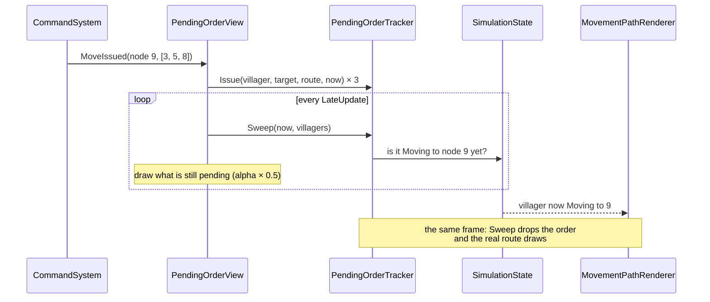

# Pending orders

> [!question] The question
> An order takes 0.3–0.5 s to reach the simulation online. How do you make the game feel
> instant *without* letting the screen show something the game hasn't agreed to?

**Where you are:** [[Home]] › [[Match]] › [[World view]] › **Pending orders** (mechanism)

## The problem

You tap. For about half a second the villager stands still, because the order is waiting
for the input delay ([[Command pipeline]] has the latency budget). Humans read anything
over about 100 ms of silence as "it didn't hear me" and tap again. But the view isn't
allowed to *move* the villager early, because that would be a lie the simulation might
contradict.

## The idea

**Acknowledge the *intent* immediately with something visibly provisional (a fainter route
in the dash style of the real ones, plus a pulse on the ordered villagers), and hand over
to the real route in the exact frame the simulation shows it.**

## How it works here

**An order ends in exactly one of four ways** (from `PendingOrderTracker`):

| Exit | Meaning |
|---|---|
| The simulation shows it | The villager is `Moving` with `targetNodeID == target`, so the real line takes over |
| A newer order replaces it | `Issue` cancels any earlier order for the same villager |
| The villager can't act | It is dead or consumed |
| 1.5 s timeout | **The only exit for a refused command.** A refusal leaves no trace in state |

**How the provisional route is made:** `Pathfinding.FindPath` over the *same current
state* the simulation will use, so it is "a close approximation rather than a promise." It
skips corner rounding, and treats a mid-edge reversal the way the simulation does.

**Order-drag preview:** while the finger is still down, the same route is drawn as a
hover preview. On release it hands over to `OnMoveIssued`, which builds the identical
route in the same frame. So there are three stages, hover → pending → real, with no flicker between them.

## Why this, not that

| Option | What you'd gain | What you'd pay | Verdict here |
|---|---|---|---|
| **Provisional preview** (chosen) | Instant acknowledgement, never contradicts the game | One more view to keep in step with the real routes | Chosen |
| Move the sprite early (client-side prediction) | Feels fully instant | The sprite and the simulation disagree. If the order is refused or the path differs, it snaps back | Rejected. Lockstep's whole promise is that the screen *is* the simulation |
| Nothing (wait) | Simplest | Feels broken. Players double-tap and spam orders | Rejected |
| Shorter input delay | Less to hide | More stalls on bad connections ([[Netcode]]) | It's adaptive already. Preview covers the rest |

> [!tip] The principle
> **You may show intent early. You may not show results early.** A provisional line says
> "you asked for this". A moved sprite would say "this happened".

## What it costs later

- **Refusals are silent.** The line just times out. Telling the player *why* (no route,
  villager in combat) would need either UI-side checks (which drift from the processor) or a
  refusal event from the simulation.
- **The 1.5 s timeout must exceed the worst normal delay.** If adaptive delay ever grows
  past it (today the maximum is 6 ticks, about 0.7 s counted from `Issue`), real orders would flicker out
  before they land.
- **Two route builders.** The pending path skips corner rounding, so the handover isn't
  pixel-identical. That was accepted deliberately.

## Traps

- **Treating `MoveIssued` as success.**
- **Clearing the provisional route in `Update` and drawing the real one in `LateUpdate`.**
  You get a one-frame gap. Sweep and draw in the same pass.
- **Keeping the tracker inside a MonoBehaviour.** It's pure on purpose: time is passed in, so tests can control it.

## Patterns you've seen before

- 🔁 [[Hide latency with honest previews]]: this note *is* the pattern's best example.
- 🔁 [[Pure core, Unity shell]]: `PendingOrderTracker` (pure, time passed in) and `PendingOrderView` (Unity drawing).
- 🔁 [[Presentation reads, never writes]]: "Read-only over SimulationState; never writes a command."

## Check yourself

> [!question]- You order a villager to an unreachable node. What does the player see, and when does it stop?
> The provisional line appears instantly. The simulation refuses the Move (`path.Length < 2`),
> so the villager never becomes `Moving` to that node. After 1.5 s the tracker's timeout
> removes the line. That is the only signal of the refusal.

> [!question]- Why does `Issue` cancel any existing order for the same villager first?
> A newer order replaces the older intent. Showing both lines would show a plan the player
> abandoned.

## Go deeper ↓

- [[PendingOrderTracker]] (100 lines, a good first read) · [[PendingOrderView]]

## My understanding

<!-- Yours. AI never edits below this line. -->
