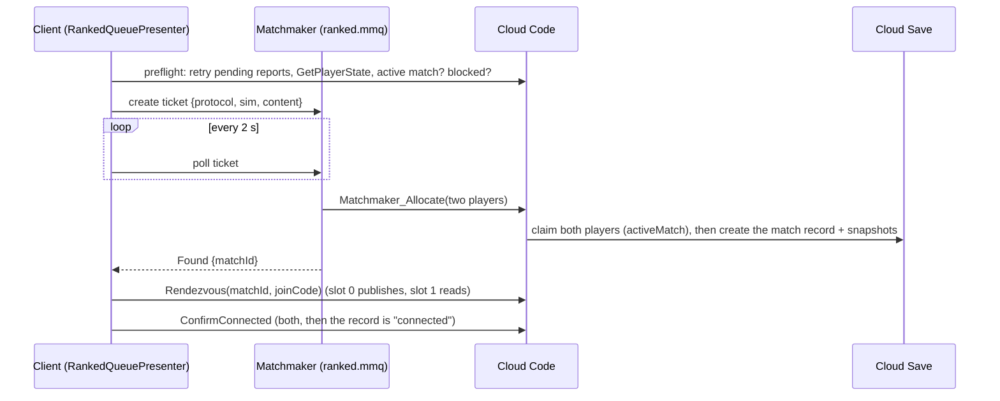

# Ranked matchmaking

> [!question] The question
> You press "Ranked". About 30 seconds later you're connected to a stranger of similar skill.
> What happened in between, and who decided each step?

**Where you are:** [[Home]] › [[Backend]] › [[Cloud]] › **Ranked matchmaking** (mechanism)

## The problem

Find a fair opponent on the *same build*, make sure neither player is already in a match or
banned, record who's playing *before* they play (so nobody can change ratings or rosters
afterwards), and then connect two phones that can't reach each other directly.

## The idea

**Four steps, each owned by a different party: the client queues (Matchmaker), the server
allocates (Cloud Code writes the match record and snapshots), the host publishes a Relay join code
through that record (rendezvous), and both confirm the connection before the draft starts.**

## How it works here

**Queue rules** (`ranked.mmq`): two players, same build identity, arena gap ≤1 (same arena
preferred for 30 s), and a rating window that widens over time: 100 → 250 → 500 → unlimited at
0/20/60/120 s. The pool times out at 300 s.

**Allocation re-checks everything** (`MatchAllocation.Allocate`): distinct players, identical and
current versions, a known balance hash, no discipline block, arena gap ≤1, then **claims** both
players' `activeMatch` and only *then* snapshots their state. The soft rating window stays a
queue preference only.

**Client side** (`RankedQueuePresenter`): up to 3 automatic requeues if the opponent's connection
fails, and a bot offer after 90 s. A poll that throws shows Retry immediately instead of waiting for the next poll.

## Why this, not that

| Decision | Alternative | Why the alternative lost |
|---|---|---|
| Server allocates before play | The first report creates the match | The reporter would choose the roster and the snapshots |
| Claim, *then* snapshot | Snapshot, then claim | A settlement finishing in between would make the snapshot stale |
| Rendezvous through the private record | UGS Lobby | Lobby is public-ish and heavier. The record already exists and only the two members can read it |
| Retries return the existing record | Create again | Allocation callbacks can be retried. Repeats must be harmless ([[Idempotency]]) |

## Check yourself

> [!question]- Why does the allocator reject callers with a *player* identity?
> Only Matchmaker should allocate. A player calling it directly could pick their own opponent.

> [!question]- Matchmaker paired two players, yet allocation refuses. Name some reasons.
> For example: a discipline block (left recent matches), an arena gap over one after a recent
> settlement, an active match claim, or a build/content mismatch with the server. The queue's
> rules are re-checked against fresh server data.

## Go deeper ↓

- [[RankedQueuePresenter]] · [[MatchAllocation]] · [[MatchRendezvous]]

## My understanding

<!-- Yours. AI never edits below this line. -->
