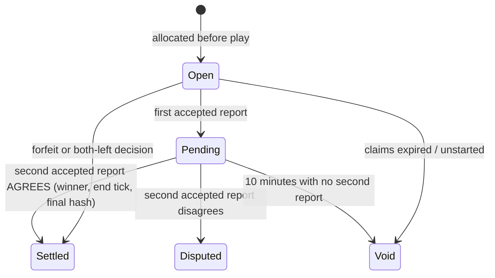

# Referee

> [!question] The question
> The server never watched the match. How does it decide a winner from an uploaded file,
> and what stops a player from uploading a fake one?

**Where you are:** [[Home]] › [[Backend]] › [[Match log]] › **Referee** (mechanism)

## The problem

Each player uploads their own log. Either could be honest, buggy or forged. The server
must accept honest results, reject forged or ineligible ones, notice disagreement, and cope
with players who never upload.

## The idea

**Check the log against what the server already knows (roster, map, pre-match snapshots,
eligibility), replay it with the same simulation, and settle only when *both* players'
accepted logs agree on the winner, end tick and final hash.**

## How it works here

For each `ReportMatch(matchId, log)` call (in `MatchReporting.Verify`):

1. **Size:** at most 512 KB.
2. **Parse:** `MatchLogFormat.TryRead`.
3. **Eligibility** (`MatchEligibility.Check`): the header identity matches the record, the map is
   the server's, each loadout is owned according to the *pre-match snapshot*, and draft choices are legal for the arena.
4. **Replay** (`Referee.Verify` → `MatchReplay.Run`): every checkpoint hash and the final hash must
   match, and a Win must reach game-over with the declared winner.
5. **Accepted** only if the replay is valid *and* ended in a win for player 0 or 1.

Then the record's state machine:

Special paths:
- **Refused reports don't use up your slot.** A later valid upload can still be accepted (refusals are kept for audit, capped at 3).
- **Both players left early:** two consistent *unfinished* logs are decided by Core breaches at the
  earlier end tick. Fewer breaches wins, a tie voids, and nobody gets a strike.
- **A forfeit outranks the logs.**

## Why this, not that

| Decision | Alternative | Why the alternative lost |
|---|---|---|
| Require two agreeing reports | Accept the first valid report | One player could upload a doctored-but-consistent log before the other |
| Pre-match snapshots for eligibility | Current inventory at report time | Items gained or lost mid-match would change the verdict |
| Void after a timeout | Wait forever | A player who never uploads would block the other's settlement |
| Disputed is terminal (no settlement) | Pick the "more plausible" log | With unsigned logs, there's no basis for choosing |

## What it costs later

- **The referee costs server time** (a full replay per report).
- **Signatures would change the rules.** With per-player command signatures, one honest log could prove the result alone.
- **One replay at a time per process** because the simulation's configuration is static.

## Check yourself

> [!question]- Player A uploads a valid log saying A won. Player B never uploads. What happens?
> The record goes Pending at A's upload. After 10 minutes (checked lazily on the next call), it
> goes Void. A lone report also adds a non-report mark to B's discipline record.

> [!question]- Why compare `finalHash` and `endTick`, not just the winner?
> Two logs could name the same winner through different histories. Matching hashes prove the
> two logs describe the *same* match.

## Go deeper ↓

- Scripts: [[MatchReporting]] (the state machine) · [[MatchEligibility]] (ownership and budgets) ·
  [[Referee (script)]] (the wrapper) · [[MatchReplay]] (the replay itself)

## My understanding

<!-- Yours. AI never edits below this line. -->
