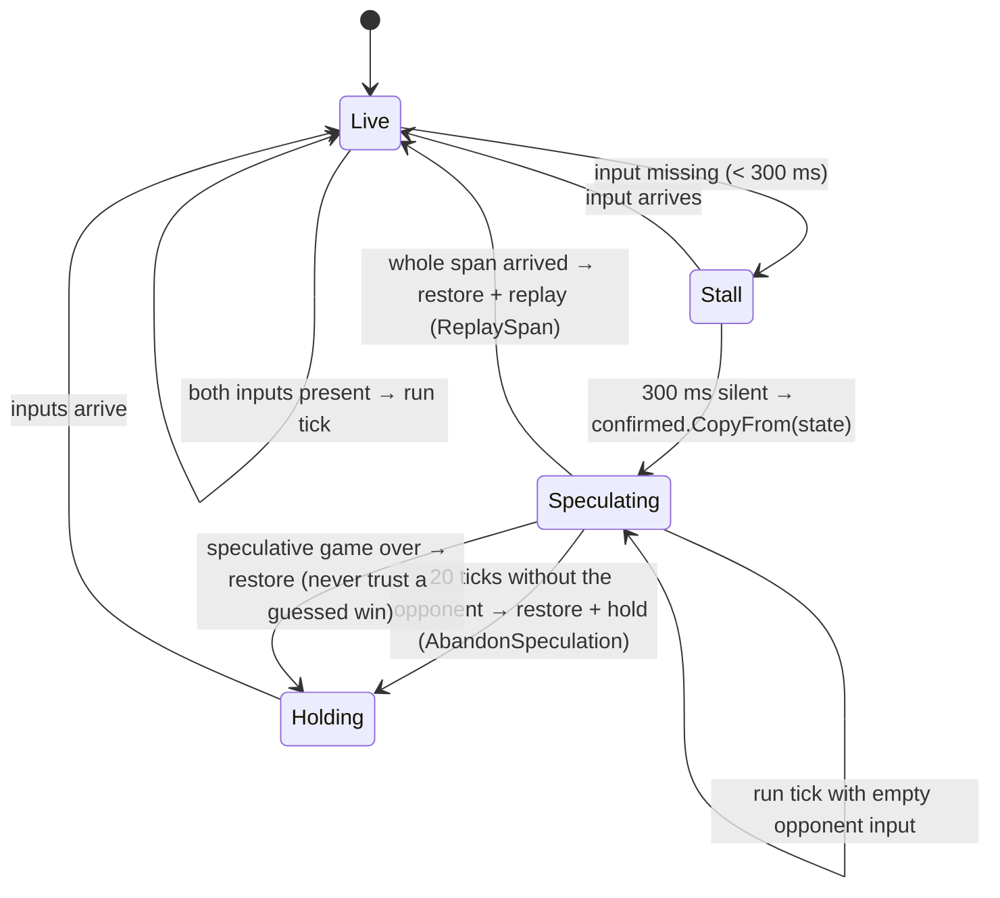

# Rollback

> [!question] The question
> The opponent's Wi-Fi drops for one second. Should both games freeze? And if they don't,
> how do you fix the "guess" once the real inputs arrive?

**Where you are:** [[Home]] › [[Match]] › [[Netcode]] › **Rollback** (mechanism)

## The problem

Plain lockstep freezes the moment an input is missing. A one-second blip on one phone
freezes both screens, which feels terrible. Playing on requires *guessing* the missing input,
and a wrong guess must be corrected without the two machines ending up different.

## The idea

**After 300 ms without new opponent input, save a copy of the confirmed state and keep
playing, guessing that the opponent did *nothing*. When the real inputs for the whole gap
arrive, restore the copy and replay those ticks with the real inputs. Give up after 20 ticks (2 s) and hold instead.**

## How it works here

Key details from `LockstepCore`:
- **Always replay**, even if the real inputs turn out empty: *"so this path runs on every blip
  instead of hiding until a rare one."* Code that only runs in rare cases is code that breaks unnoticed.
- **Only confirmed ticks count.** Speculative ticks are never recorded in the match log, never
  hashed, never compared. The replay pass is the one that records and hashes.
- **Effects don't play twice.** Replay raises no `TickSimulated`, so a death seen during speculation doesn't flash again.
- **Restore in place.** `simState.CopyFrom(confirmed)` overwrites the *same* object, so views
  holding references to it keep working. `RolledBack` tells them to clean up units that no longer exist.
- **Your own inputs are kept.** They were already sent, and the peer will apply them on those ticks too.
- **The banner** ("unstable link") appears only after 5 speculative ticks, so short blips are invisible.

## Why this, not that

| Option | Gain | Pay | Verdict |
|---|---|---|---|
| **Copy once per disruption, replay on recovery** (chosen) | Zero cost when nothing goes wrong | One full-state copy per blip, and a visible snap if the guess was wrong | Chosen |
| GGPO-style snapshot every tick | Can roll back from any point instantly | Copying the whole state 10× a second, all the time | Unneeded: rollback is the exception here |
| Freeze (plain lockstep) | Simplest, never wrong | Every hiccup freezes both players | The original behaviour, which this replaced |
| Predict the opponent's *likely* action | Fewer snaps | Complex, and still sometimes wrong | "Did nothing" is right on most ticks |

## What it costs later

- **Every state field must be copyable.** `SimulationStateCopyTests` use reflection to catch fields `CopyFrom` misses.
- **Views must survive arrays shrinking** (units spawned during speculation disappear).
- **How the snap feels** still needs two-player tuning.

## Check yourself

> [!question]- During speculation your army wins the game. Why doesn't the end card show?
> A speculative game over isn't a result: nobody confirmed the inputs that produced it. The
> core restores the confirmed state immediately and holds until the real inputs decide.

> [!question]- Why must the hash and the match log ignore speculative ticks?
> They might be rewritten. The peer never played that guessed version, so its hash would
> "disagree" and false-alarm a desync, and the log would record a match that never happened.

## Go deeper ↓

- [[LockstepCore]]: `CanSpeculate`, `BeginSpeculation`, `ReplaySpan`, `AbandonSpeculation`

## My understanding

<!-- Yours. AI never edits below this line. -->
