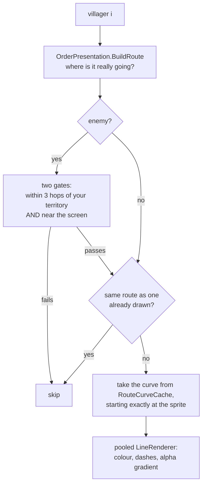

# Route lines

> [!question] The question
> How does the game draw dashed lines showing where every unit is heading: smooth,
> readable with 50 units moving, cheap to redraw every frame, and without revealing
> what the enemy is doing?

**Where you are:** [[Home]] › [[Match]] › [[World view]] › **Route lines** (mechanism)

## The problem

Four separate problems:

1. **Shape.** The board is a grid, so paths are right-angle staircases, and a line along
   them doesn't show which way a unit will turn until it reaches the corner.
2. **Clutter.** Ten villagers sent together from one node would draw ten identical lines on the same pixels.
3. **Cost.** This runs every frame for every moving unit, so creating garbage each frame causes stutter.
4. **Fairness.** Showing enemy routes in full gives away their plan. Hiding them entirely
   removes useful information.

## The idea

**One renderer for the whole board, a pool of Unity `LineRenderer`s, one line per
*distinct* route, geometry read from the same rounded curve the sprites walk on, and enemy
routes *cut* (not just faded) to a short stub near your territory.**

## How it works here

Each `LateUpdate` (after every sprite has moved this frame), for each villager:

The pieces:

| Piece | What it does | Why |
|---|---|---|
| **Shared curve** | Reads the curve `VillagerView` cached this frame ([[PathCurve]]) | Line and sprite always agree |
| **Start at the sprite** | `LegFraction` uses the same `TickAlpha` maths as [[Smooth movement between ticks]] | The line's head sits *on* the unit, not a frame behind |
| **Deduplicate** | `AlreadyDrawn` compares routes over the stretch that will be shown | A squad reads as one line |
| **Pool** | `GetLine(slot)` creates `LineRenderer`s only when the pool is too small. Unused ones are disabled, never destroyed | No allocations or garbage per frame ([[Object pooling]]) |
| **Dashes** | `textureMode = Tile`, `textureScale = 1 / dashSpacing` | The texture repeats along the line, so the dash spacing is set in world units |
| **Faces the camera** | `alignment = View` | A flat ribbon that's always readable from the tilted camera |
| **Layering** | Sorting layer above the ground, below villagers | Lines lie on the board without covering units |
| **Your routes** | Bright when freshly ordered, settling to dimmer as they age. Amber and dashed when interrupted or held at a Pier | A busy board stays readable, and a problem stands out |
| **Enemy routes** | At most 2 legs shown, fading from near to far (fade measured in *nodes*), dimmed as they go off-screen | You learn the threat without learning the plan |

### The fairness decision, quoted

> *"Drawing a whole route and tapering its alpha would leave the destination on screen for
> anyone who raises their brightness; the route is truncated instead, and the fade only
> shapes what survives the cut."*

And the two gates cover each other's gaps: on-screen alone would reward zooming out, and
hop range alone would draw routes for units you can't see.

## Why this, not that

| Decision | Alternative | Why the alternative lost |
|---|---|---|
| One board-wide renderer | A `LineRenderer` on each villager | Can't deduplicate a squad. N identical lines stack up |
| Corner rounding (quadratic Bézier at corners only) | Chaikin smoothing, or a spline through all points | Those move the waypoints. Here each node must stay *on* the curve, because legs are timed in ticks |
| Truncating enemy geometry | Fading enemy routes with alpha | Fading still draws the information |
| `LineRenderer` | A custom mesh or a shader | Built-in, with dashes, gradients and camera-facing for free. A custom mesh is worth it only if profiling says so |
| Reused key arrays and lists | `new Gradient()` per line per frame | Garbage every frame leads to garbage-collection stutter on phones |

## What it costs later

- **Order of execution matters.** The renderer *must* run after `VillagerView` has placed
  sprites and cached curves. That's why it uses `LateUpdate`. A refactor that moves either breaks the alignment.
- **Global scratch buffers.** `PathCurve` uses static lists, so callers must copy anything
  they keep, and it's main-thread only.
- **Pool size is the peak number of routes.** Lines are never destroyed during a match. That's fine at this scale.
- **Information gating is a design lever.** Changing reveal legs or hop range changes what
  players know, so it's a balance decision, not just a visual one.

## Traps

- **Building a second curve** with different settings. Units drift beside their lines.
- **Allocating in `LateUpdate`** (`new List`, `ToArray`, LINQ, string concatenation).
- **Using the 0–1 line parameter for distances.** Truncation stretches it. The code converts the fade to *nodes* first.
- **Gating with alpha alone** for anything an opponent shouldn't see.

## Patterns you've seen before

- 🔁 [[Presentation reads, never writes]]: "Read-only over SimulationState, like every other view component."
- 🔁 [[One source of geometry]]: the sprite and the line read one curve, and the pending preview reuses the dash material.

## Check yourself

> [!question]- Five of your villagers stand on node 4 and you send them to node 9. How many `LineRenderer`s are enabled for them?
> One. They share the identical remaining route, so `AlreadyDrawn` collapses the other four.

> [!question]- Why `LateUpdate` and not `Update`?
> `VillagerView.Update` places the sprite and fills the curve cache for this frame. Drawing in
> `Update` could run before that, leaving the line's head one frame behind the unit.

> [!question]- An enemy villager is 2 hops from your land but off-screen to the left by 0.2 screen widths. Is its route drawn?
> Only if `offScreenFade` is above 0.2. If so, it's drawn dimmed by `1 − 0.2 / offScreenFade`. Otherwise it's skipped.

## Go deeper ↓

- [[MovementPathRenderer]]: the script, read in order
- [[PathCurve]]: the corner-rounding geometry

## My understanding

<!-- Yours. AI never edits below this line. -->
