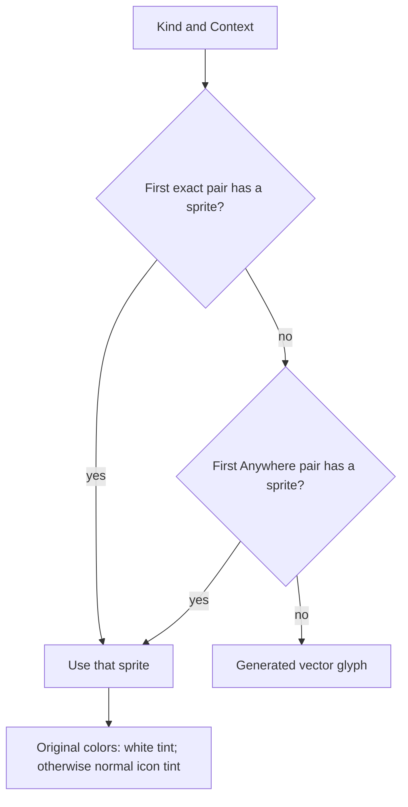

# Semantic icons and fallbacks

> [!question] The question
> If Food needs one picture in the HUD and another in a node sheet, how do you express that without teaching either screen about sprite selection?

**Where you are:** [[Home]] › [[Lobby]] / [[Match]] › [[UI art]] › **Semantic icons and fallbacks** (mechanism)

## The problem

“Use this sprite” couples the caller to an asset. “Show Food here” lets art change independently. But adding overrides raises another question: what happens when an override is missing, empty or duplicated?

## The idea

**Resolve the first entry for the exact kind/context pair, then the first Anywhere entry for that kind, then generated art.**

## How it works here

`UIArtLookup` makes the precedence decision without Unity asset types. Its comment is precise: “First wins per pair; empty exact art can fall back to Anywhere.” It does **not** keep looking through duplicates for a nonempty sprite.

| Ordered theme rows for Food | Request: Food / NodeSheet | Why |
|---|---|---|
| Anywhere sprite A; NodeSheet sprite B | B | Exact beats Anywhere even when later in the array |
| Empty NodeSheet; NodeSheet sprite B; Anywhere sprite A | A | Empty first exact entry hides the later exact duplicate |
| Empty Anywhere; Anywhere sprite A | Generated glyph | Empty first Anywhere entry hides its duplicate too |
| HeadsUpDisplay sprite A | Generated glyph | Another specific location is not a fallback |

`LobbyIconUsage` supplies actual locations and labels to the Inspector drawer and runtime diagnostics. Anywhere is a theme wildcard, not an actual runtime location in that metadata. The drawer resets incompatible contexts when changing kind, preserves unknown saved kinds, and avoids rewriting a valid single-location override just because you opened the Inspector.

`LobbyIcon` ignores picking, fits the image to its box, and uses `keepOriginalColours` to choose white tint. Inside the lobby it first tries a bundled white Phosphor Bold SVG chosen by kind, so the theme lookup below applies to match, shop and other surfaces; the Phosphor icons are tinted by USS. `None` has no generated image; an unknown kind receives a placeholder. Generated glyphs are cached by kind.

## Why this, not that

| Decision | Alternative | Gain | Cost |
|---|---|---|---|
| Kind plus context | Separate icon kind for every location | Shared meaning with local art overrides | Call sites must supply honest contexts |
| First row wins | Last row wins or first nonempty wins | Explicit, testable precedence | An empty duplicate can surprise an artist |
| Procedural glyph after lookup failure | Blank image or exception | Partial art packs remain usable | Missing art can be less obvious without diagnostics |
| Shared usage table | Inspector-only menu list | Authoring choices and diagnostics agree | New usages need table maintenance |

## What it costs later

Serialized values outlive the current menu. Kinds are append-only; context zero remains Anywhere, and context 11 is reserved for the retired SuitTree location. That is compatibility work even though the values describe presentation. A new semantic icon also needs fallback drawing and coverage, not just an enum member.

## Traps

- Adding a second exact row will not repair an empty first one. Fix the first row or remove the duplicate.
- Runtime validation happens after UXML attributes are applied on attachment, avoiding diagnostics about temporary Kind/Context combinations.
- The generic lookup itself does not validate active usages. Metadata validation and sprite precedence are separate jobs.
- The pure lookup tests live in `dotnet/NodeWar.View.Tests`, not in a Unity painter test run.

## Patterns you've seen before

- 🔁 [[Pure core, Unity shell]]: pure precedence underneath Unity sprites and painting.
- 🔁 [[Numbers on the wire are forever]]: the same stable-number habit protects serialized theme assets.
- 🔁 [[Treat bad input as a case you already handle]]: absent art takes the normal fallback path.

## Check yourself

> [!question]- An empty NodeSheet row comes before a filled NodeSheet row. Does the second row win?
> No. The first pair is authoritative even when empty. Anywhere may still supply art; otherwise the icon uses its generated glyph.

> [!question]- Why does an original-color sprite use white tint?
> Multiplying by white preserves its colors. Applying the normal resource or USS tint would recolor it.

## Go deeper ↓

- [[UIArtLookup]]: the small policy function first
- [[UIArtTheme]]: asset adaptation and loading
- [[LobbyIcon]]: the visual element consuming the result

Sideways → [[Shared UI theme]] · [[Three UI stacks]]

## My understanding

<!-- Yours. AI never edits below this line. -->
