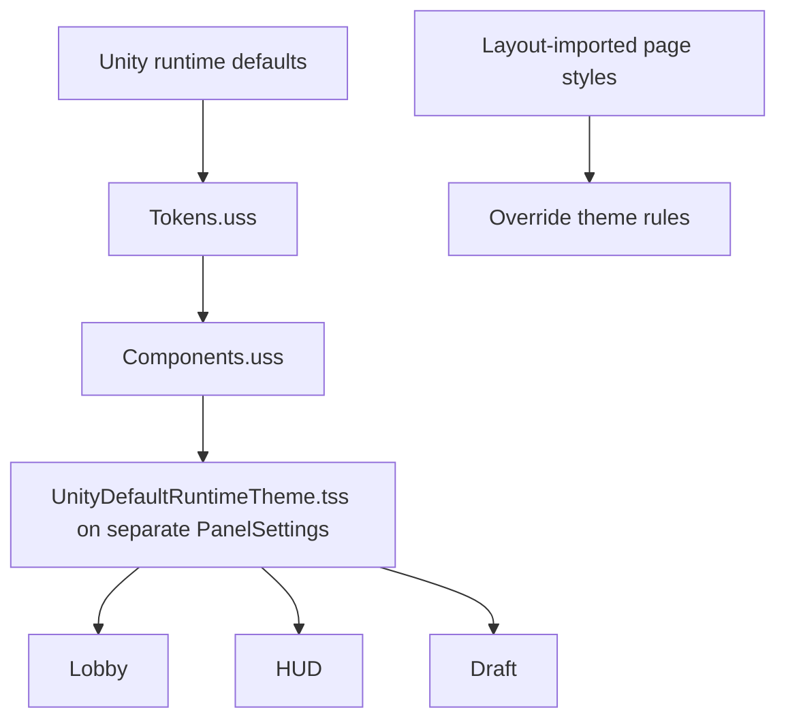

# Shared UI theme

> [!question] The question
> How can separate lobby, HUD and draft panels look like one game while each keeps control of its layout?

**Where you are:** [[Home]] › [[Lobby]] / [[Match]] › [[UI art]] › **Shared UI theme** (mechanism)

## The problem

Copy a button style into every screen and the copies drift. Share every layout value and one screen's needs constrain all the others. Color adds a subtler problem: two things can share the same blue today without meaning the same thing tomorrow.

## The idea

**Share visual meaning and reusable components through the panel theme; keep screen layout decisions in screen stylesheets.**

## How it works here

The theme imports Unity defaults, tokens, then components. `Tokens.uss` separates raw `--pal-*` colors from role tokens such as `--surface` and `--action`. Its reason is worth keeping: “Two jobs that happen to share a colour today get two tokens, so they can part later without a search through every page.”

Shared `ui-` components read meaning tokens. Page styles use their own names, such as lobby `lb-` classes. Card width and page padding belong to their owner, rather than automatically becoming global tokens. Real Fredoka Medium, SemiBold and Bold assets back the weight classes; glyph art handles symbols that font does not carry.

The important USS rule is recorded in `Components.uss`: a theme rule “loses to ANY rule in a stylesheet a layout imports, whatever the specificity.” Increasing the theme selector's specificity does not solve that precedence boundary.

`ItemTint` connects stable item IDs to tint classes; the colors remain in tokens and components. Its comment chooses identity over perfect neighbor contrast: coloring by list position could make an item change color between its slot and the list.

## Why this, not that

| Decision | Alternative | Gain | Cost |
|---|---|---|---|
| Meaning tokens over raw palette access | Read raw colors everywhere | Roles can diverge during a reskin | Another naming layer to maintain |
| Shared theme over copied styles | Screen-local copies of every component | Fix shared design once | A shared change reaches multiple screens |
| Separate PanelSettings | Couple all surfaces to one panel configuration | Tune panels independently | Setup must assign the common theme consistently |
| Stable ID tint | Tint by list position | Identity survives reordering | Tint collisions are accepted |

## What it costs later

Shared tokens create deliberate coupling. Changing a role should prompt checks across lobby and match. A palette expansion for item placeholders must agree with `ItemTint.Count`, the token set and component classes. The setup scripts create serialized roots and panel assets through Unity; textual style changes alone cannot prove the right asset is assigned in a scene.

## Traps

- Treating USS as browser CSS can send you toward unsupported properties or the wrong precedence fix. Read the component header's recorded substitutions.
- Ownership is not item-family color. Tokens require a shape or label alongside player color.
- A layout reskin must preserve binding names and element types. `UiRequired` logs a diagnosis in Editor/development builds and returns the queried result; it does not abort all binding or recreate the element.
- XML contract tests can check authored names and hierarchy; they cannot establish how it renders or receives touches.

## Patterns you've seen before

- 🔁 [[Presentation reads, never writes]]: visual roles do not decide gameplay ownership.
- 🔁 [[One source of geometry]]: the related habit is to give shared facts one owner; here that owner is tokens/components rather than copied screen rules.
- 🔁 [[Pure core, Unity shell]]: stable tint selection is pure; USS and panels render it.

## Check yourself

> [!question]- A low-specificity page rule defeats a very specific theme rule. Is that necessarily a selector bug?
> No. Layout-imported styles beat theme rules across this precedence boundary regardless of specificity, as recorded in Components.uss.

> [!question]- Why give two currently equal colors separate role tokens?
> Their meanings can change independently later. Separate tokens preserve that choice without a search through every screen.

## Go deeper ↓

- [[LobbyIcon]]: a visual element styled by tint
- Open the theme, token and component files listed in frontmatter together.

Sideways → [[Three UI stacks]] · [[Match UI]] · [[Lobby UI]] · [[Test evidence]]

## My understanding

<!-- Yours. AI never edits below this line. -->
