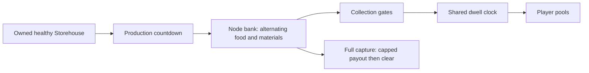

# Storehouse collection

> [!question] The question
> Why can a Storehouse hold valuable stock while its owner receives nothing, and what does a capture do to that stock?

**Where you are:** [[Home]] › [[Match]] › [[Economy]] › **Storehouse collection** (mechanism)

## The problem

Direct worker income goes straight into a player pool. A bank instead needs local inventory, a collection clock and rules for contested territory. Without shared rules, a UI could call a bank “collecting” while the simulation has paused it.

## The idea

**Separate making stock from transferring it, and let collection pause safely while ownership, enemies or player caps block payment.**

## How it works here

In `Default()`, the bank holds 5 units and produces one every 80 ticks before tempo. It needs no worker slot. Full capacity or failed production eligibility pauses the production countdown.

Collection needs either `collectRequested` or a stationary friendly collector. A collector must have positive HP, be unconsumed and be Idle or Working at the node. Idle minions qualify. More collectors do not multiply the rate: the code calls it “One shared dwell clock, independent of production tempo.”

| Gate or outcome | Effect |
|---|---|
| Neutral owner, incomplete owner-side claim bar, or living enemy body at node | Locked; active collection progress pauses |
| All bank resources point to full player pools | Progress pauses |
| Food pool full, but bank has materials and material room | Skip food and collect materials |
| No request and no stationary collector | Reset dwell progress |
| Bank becomes empty | Clear progress and request |

Default collection adds 5 progress per tick and pays one unit at 16. Starting at zero: 5, 10, 15, then 20 pays a unit and leaves 4. The next payment needs three more eligible ticks. Food is preferred, then materials, then metal, skipping full destinations. A tick transfers at most one unit.

The read-only `CollectionState` reports Neutral before Locked, Locked before Empty, then StorageFull, Collecting or Waiting. A remote request may be accepted while locked: “A locked owner's request is accepted; the production pass pauses it.” Cancellation resets progress only if no stationary collector remains.

Neutralisation preserves stock and stops collection. Full capture pays the bank to the new owner subject to player caps, then clears stock and the production timer. Overflow is lost; it is not left behind to collect later.

## Why this, not that

| Choice | Gain | Cost |
|---|---|---|
| Local stock before player income | Territory can hold a contested reward | Extra inventory, locks and timers |
| Shared dwell clock | Collector count cannot multiply collection speed | Several collectors offer no rate bonus |
| Accept locked requests and pause | Intent survives a temporary lock | “Requested” does not imply currently paying |
| Skip capped resources | Other usable stock can still transfer | Resource priority needs explicit ordering |
| Always pay direct to the owner instead | Simpler arithmetic | Removes the collection and bank-capture decisions |

## What it costs later

New bank resources would touch total stock, destination room, transfer order and capture payout together. UI status must still call the same helpers. [[BankRules]] returns a modified node struct during collection, so simulation callers must write it back even though player pool increments happen inside the helper.

## Traps

- Scaling collection by production tempo.
- Resetting progress whenever a lock appears; a lock pauses it.
- Assuming cancellation overrides a stationary collector.
- Keeping overflow stock after full capture; capture clears the bank after its capped payout.

## Patterns you've seen before

- 🔁 [[Presentation reads, never writes]]: bank status is a query over the same payment gates.
- 🔁 [[Make retries safe]]: Collect sets request value 0 or 1 rather than toggling it.

## Check yourself

> [!question]- Food is capped but the bank contains food and materials. Must collection stop?
> No. If the material pool has room, it skips food and pays materials. It stops for storage only when none of the stocked resources can fit.

> [!question]- Two idle friendly minions stand on the bank. Is collection twice as fast?
> No. They satisfy the stationary-collector condition, but there is still one node dwell clock.

## Go deeper ↓

- [[BankRules]]: exact state precedence, locks and transfer order
- [[DistrictHealth]]: full-health production gate
- [[GameBalanceData]]: capacity and collection tuning

## My understanding

<!-- Yours. AI never edits below this line. -->
