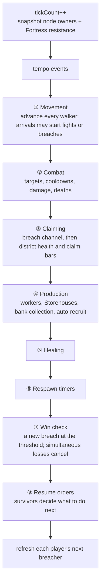

# The tick

> [!question] The question
> What happens inside one tick, in what order, and why would swapping two lines of
> `SimulateTick` change who wins a fight?

**Where you are:** [[Home]] › [[Match]] › [[Simulation]] › **The tick** (mechanism)

## The problem

In one tick, many things happen "at the same time": units arrive, fights start, claim bars
move, resources tick up, the dead respawn, someone might win. A computer can't do them
simultaneously. It has to pick an order, and the order changes the outcome. Did the
villager arrive *before* the node flipped, or after? If two machines pick different
orders, they desync. If one machine's order changes between versions, old replays break.

## The idea

**One canonical order, written once in `SimulateTick`, never reordered: movement → combat
→ claiming → production → healing → respawns → win check → resume. Where a step must not
see changes made earlier in the same tick, it reads a snapshot taken at the start of the tick.**

## How it works here

Commands are applied *before* `SimulateTick` is called, by the driver ([[Command pipeline]]).

### Why some lines are where they are

- **Snapshot first.** Claiming reads `ownersAtTickStart`, not live owners. If node A flips
  in step ③, node B's frontier bonus in the *same* step still sees the old owner. Otherwise
  the result would depend on whether A or B came first in the array.
- **Resume is last, on purpose.** The source says it: *"Combat resolves, deaths happen,
  THEN survivors figure out what to do next."* This stops a villager from killing an enemy
  and starting to claim in the same tick, which would interact strangely with step ③.
- **Win check after respawns.** Everything that can change who has what has already
  happened when the game asks "did anyone win?"

### How movement works in integers

A villager on a leg has `moveProgress` (ticks walked) and `moveLegDurationTicks` (ticks the
leg takes, fixed when it departs). Each tick, `moveProgress++`. When
`moveProgress >= moveLegDurationTicks`, it arrives, and every arrival checks for enemies
and the enemy Core. Leg duration is `link weight × speed`, divided for an owned Pier using
**ceiling division** `(ticks + d − 1) / d`, so integer division rounds *up* rather than
giving free speed.

## Why this, not that

| Decision | Alternative | Why the alternative lost |
|---|---|---|
| One central ordered function | Each entity runs its own `Update` | Unity's `Update` order between objects is not guaranteed. The rules need it to be |
| Start-of-tick snapshots | Read live values | Results would depend on array position: node 3 would see node 2's new owner but not node 4's |
| Fixed 10 Hz | Variable time step using frame time | Frame times differ per machine. Fixed steps are identical everywhere ([[Fixed timestep]]) |
| Low tick rate (10 Hz) | 30 or 60 Hz | An RTS doesn't need twitch precision. Fewer ticks means smaller logs, cheaper replays and more slack for the network |

## What it costs later

- **Every new rule needs a place in this order**, and that choice is part of the rule.
  Moving a step is a behaviour change: bump `SimulationVersion` and review the pinned baselines.
- **The function knows everything.** Movement, combat and economy are linked through this
  sequence, so splitting `GameSimulation` into separate systems must keep it exactly.
- **Allocations every tick.** `ownersAtTickStart` is a fresh array every tick. Reusing a
  buffer is a free optimisation, as long as nothing else changes.

## Traps

- **"Just moving" a call** a few lines up to fix a bug. That changes results for every match.
- **Reading live ownership where a snapshot exists.**
- **Making a rule depend on an event** in `TickEventLog`.
- **Making the number of ticks depend on anything** but the driver's fixed loop.

## Patterns you've seen before

- 🔁 [[Same code, three places]]: this exact sequence runs on both peers, in the referee and in the rig.
- 🔁 [[Pure core, Unity shell]]: `SimulateTick` is pure. `TickRunner` is the Unity shell that decides *when* to call it.

## Check yourself

> [!question]- If combat ran *before* movement, what would change for a villager arriving at a node held by an enemy?
> Today it arrives (step ①), is marked Fighting, and combat (step ②) can already process it
> in the same tick. With combat first, it would arrive *after* combat had run, and the fight
> would start one tick later. That is 100 ms of difference in every engagement, and every
> existing replay would produce a different result.

> [!question]- Why ceiling division for Pier travel?
> Integer division truncates: 7 / 2 = 3. For travel time, truncating would make some legs
> faster than intended. `(7 + 2 − 1) / 2 = 4` rounds up. Choosing the rounding direction on
> purpose is part of writing integer rules.

## Go deeper ↓

- [[GameSimulation]]: the script, and how to read 1,500 lines
- [[TickRunner]]: the loop that calls it

## My understanding

<!-- Yours. AI never edits below this line. -->
