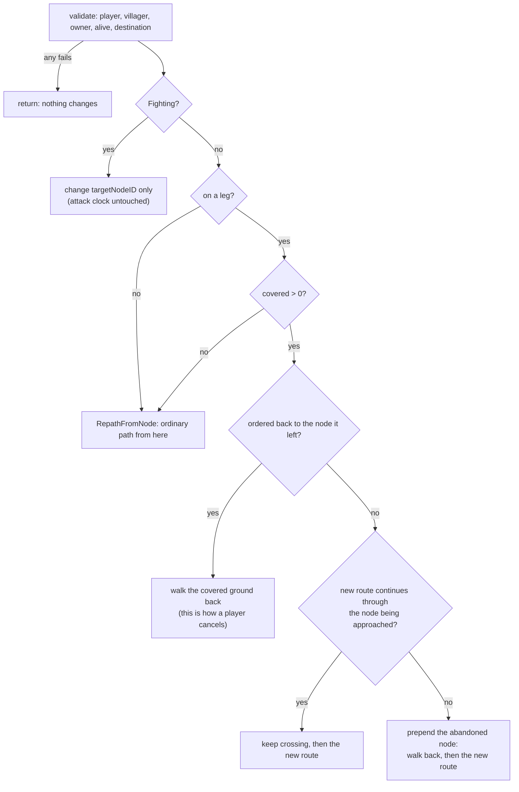

# CommandProcessor

> [!question] The question
> When a command finally reaches the simulation, how is it judged, and how does a Move
> order to a villager that is *halfway along a path* avoid teleporting it?

**Where you are:** [[Home]] › [[Match]] › [[Commands]] › [[Command pipeline]] › **CommandProcessor** (script)

**Open:** [CommandProcessor.cs in VS Code](vscode://file/C:/Dev/NodeGame/Assets/Scripts/Game/Simulation/CommandProcessor.cs)

## What it is

A `static class` inside `Simulation/`, with no Unity and integers only. `ProcessCommand` is a
`switch` over `CommandType` that sends each command to a `Process…` method. Every method
follows the same shape: **check everything, and return silently on any "no"; only then
change state.**

> [!info] The file in one breath
> `ProcessCommand` (switch) · `ProcessMoveCommand` (the hard one) · `RepathFromNode` ·
> `ApplyMove` · `Rescale` · one short method per economic action, each with a
> `NodeActionRules.Can…` guard first.

## Read it in this order

### 1. `ProcessCommand`: the switch

Nine cases, one per command type (`None` does nothing). If a new command type has no case
here, it's silently ignored. That's why adding one is a single-commit, many-file change.

### 2. A simple case first: `ProcessSetAutoRecruit`

```csharp
if (command.villagerID != -1 ||
    !NodeActionRules.CanSetAutoRecruit(state, command.playerID, command.targetNodeID, command.value)) return;
state.nodes[command.targetNodeID].autoRecruit = command.value == 1;
```

That's the pattern in two lines: a **sentinel check** (`villagerID` must be −1 for node actions),
a **rule check** shared with the UI (`NodeActionRules`), then **one write**.

### 3. `ProcessMoveCommand`: read the comment first

The comment states the problem exactly: a villager in transit has no position of its own,
only `currentNodeID` plus `moveProgress` against the current leg. The old code re-pathed
from `currentNodeID`, which "rewound the villager onto that node and threw the crossing
away", so repeated orders could freeze a unit in place, and turning around was free.

The decision tree:



The clever part: **a reversal is just forward travel along a path that starts with the node
being walked away from.** The tick loop's movement code needs to know nothing about reversals.

### 4. `ApplyMove`: the one place a path is installed

It sets `targetNodeID`, checks `PierGate.BlocksDeparture`, sets `movePath`, `movePathIndex = 0`
and `moveProgress`, fixes the leg duration (`BeginLeg`), sets the state to `Moving`, and clears the combat target.

### 5. `Rescale`: integer maths done carefully

```csharp
int scaled = (covered * toTicks) / fromTicks;   // multiply first, then divide
```

Dividing first would lose precision: `(7 / 10) * 20 = 0`, but `(7 * 20) / 10 = 14`. The
comment notes that every current board has uniform edge weights, so this is a safeguard for
future boards with mixed weights.

## C# details worth noticing

- `state.villagers[i].targetNodeID = …` writes **through the array**. `VillagerData` is a
  `struct` (a value type), so `var v = state.villagers[i]; v.x = 1;` would change a *copy*.
  This file either writes through the array or uses `ref state.villagers[i]`.
- `out _` discards an out-parameter you don't need.

## Tests that pin it

Simulation command and economic-refusal tests in `dotnet test dotnet/NodeWar.sln`, including
sticky orders, reversal and refusal atomicity (a refused command leaves *no* partial change).

## Check yourself

> [!question]- A villager is 6 ticks into a 10-tick leg from A to B. You order it to C, which is reached through A, not B. What path does it get, and how much progress?
> The reversed path `[B, A, …route to C]`, with progress 10 − 6 = 4 on the B→A leg. It
> walks back the 6 ticks it covered, then continues.

> [!question]- Why does a Fighting villager only get its `targetNodeID` changed?
> Orders during combat change *intent* without resetting the attack clock or fight state.
> Otherwise spamming orders mid-fight could reset cooldowns or break out of combat. The
> villager resumes towards the new target after the fight, in the last step of the tick.

## Go deeper ↓

This is the lowest shell. Below it is the code itself.

## My understanding

<!-- Yours. AI never edits below this line. -->
