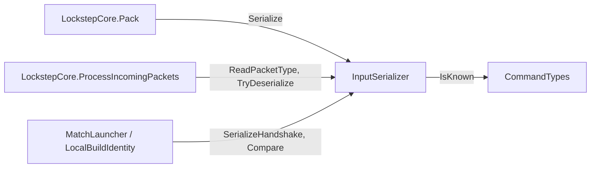

# InputSerializer

> [!question] The question
> How does a `TickInput` struct become bytes on the wire and back, and how do you read
> this file without getting lost?

**Where you are:** [[Home]] › [[Match]] › [[Netcode]] › [[Tick packets]] › **InputSerializer** (script)

**Open:** [InputSerializer.cs in VS Code](vscode://file/C:/Dev/NodeGame/Assets/Scripts/Game/Network/InputSerializer.cs) · [Commands.cs](vscode://file/C:/Dev/NodeGame/Assets/Scripts/Game/Simulation/Commands.cs)

## What it is

A `static class` with no state: bytes go in, structs come out, and the reverse. It owns
the layout of every in-match packet (tick inputs, handshakes, heartbeats, emotes, draft
acks) except the draft payloads, which belong to `DraftSerializer`.

> [!info] The file in one breath
> 12 packet types · 1 struct for tick input · 1 struct for build identity ·
> pairs of `Serialize…` / `TryDeserialize…` functions · four tiny byte helpers at the bottom.

## Read it in this order

### 1. `PacketType`: the first byte of every packet

```csharp
public enum PacketType : byte
{
    Handshake = 0, HandshakeAck = 1, TickInput = 2, Heartbeat = 3,
    DraftReady = 4, DraftPlacement = 5, DraftLoadout = 6, DraftAck = 7,
    Emote = 8, HandshakeReject = 9, MatchSetup = 10, MatchSetupAck = 11
}
```

The receiver reads byte 0 and decides which reader to call. `: byte` makes the enum
exactly one byte. The numbers are part of the protocol: never reorder them.

### 2. `TickInput`: what one player sends for one tick

Compare its fields with the byte diagram in [[Tick packets]]. Each field is one row of that diagram.

### 3. `Serialize`: struct → bytes

```csharp
int size = HEADER_BYTES + (commandCount * BYTES_PER_COMMAND);
byte[] data = new byte[size];          // exact size: never padded
data[offset++] = (byte)PacketType.TickInput;
WriteInt(data, ref offset, input.forTick);
// …header…
for (int i = 0; i < commandCount; i++)
{
    if (!CommandTypes.IsKnown(input.commands[i].type)) throw …;   // fail loudly here
    WriteInt(data, ref offset, (int)input.commands[i].type);
    // …five more ints…
}
```

The pattern to notice is `ref offset`. Every writer advances one shared cursor, so the
code reads top to bottom in the same order as the bytes.

### 4. `TryDeserialize`: bytes → struct, with three guards

```csharp
if (commandCount < 0) return false;
if (commandCount > (data.Length - HEADER_BYTES) / BYTES_PER_COMMAND) return false;  // divide: can't overflow
if (data.Length != HEADER_BYTES + commandCount * BYTES_PER_COMMAND) return false;   // exact, not "at least"
```

`Try…` plus an `out` parameter is the C# convention for "this can fail and that's
normal". It returns `false` instead of throwing, because bad packets are expected traffic,
not bugs. Why the length must match *exactly*: `Serialize` never pads, so any other
length means the sender is using a different layout, such as an older build.

### 5. `WriteInt` / `ReadInt`: [[Endianness|little-endian]] by hand

```csharp
buffer[offset]     = (byte)(value);        // lowest 8 bits
buffer[offset + 1] = (byte)(value >> 8);
buffer[offset + 2] = (byte)(value >> 16);
buffer[offset + 3] = (byte)(value >> 24);  // highest 8 bits
```

Try it: `300` is `0x0000012C` in hex, so it becomes the bytes `2C 01 00 00`. The
lowest byte goes first, and that is all "little-endian" means. Spelling the shifts out
guarantees the same bytes on every CPU, unlike `BitConverter`.

### 6. `Compare`: may these two builds play each other?

The order of the checks is the lesson: **protocol** first (can we even read each other's
packets?), then **simulation** version (would the same commands produce the same game?),
and only then **content** (the same code with different balance data gives
`ContentMismatch`). See [[Build identity handshake]].

## Who uses it



It calls nothing except `CommandTypes.IsKnown`. A leaf like this is the easiest kind of
file to test and the safest to change, *as long as the layout stays the same*.

## Change recipe

Adding a field to `GameCommand` touches, **in one commit**: `Commands.cs` (the struct),
`InputSerializer` (`BYTES_PER_COMMAND`, `Serialize`, `TryDeserialize`),
`ProtocolVersion.Current` (bump), and a new `TICKS` tag in the match log format. Then
run `dotnet test dotnet/NodeWar.sln`.

## Tests that pin it

- `dotnet/NodeWar.Lobby.Tests/PacketRobustnessTests.cs`: round trips, every truncated
  prefix, out-of-range counts, length mismatches and random garbage (which must never throw)
- `dotnet/NodeWar.Lobby.Tests/NodeCommandWireTests.cs`: the newer command types
  round-trip, and unknown types are refused
- `dotnet/NodeWar.Network.Tests/`: the whole loop over a simulated bad connection

## Try it

> [!example] Exercise: predict the bytes
> Write down the 39 bytes for one `Move` command (type 1, player 0, villager 7, node 12,
> issued on tick 98, value 0) on tick 100 with no hash and delays 2 and 0. Then serialize
> it in a scratch test and compare. If any byte surprises you, you've found something to
> write in **My understanding**.

## Check yourself

> [!question]- Why is `TryDeserialize` a `Try…` method that returns `bool`, while `Serialize` throws?
> Bad *incoming* bytes are expected (loss, corruption, hostile peers) and should be dropped
> quietly. A bad *outgoing* command is a bug in our own code and should fail loudly where it happens.

> [!question]- What would break if someone changed `BYTES_PER_COMMAND` to 28 on only one machine's build?
> Every tick packet from the other build would fail the exact-length check and be dropped
> as lost, and the match would stall. In practice the protocol bump this change requires
> makes the handshake refuse the match before that can happen.

## Go deeper ↓

This is the lowest shell. Below it is the code itself.

## My understanding

<!-- Yours. AI never edits below this line. -->
