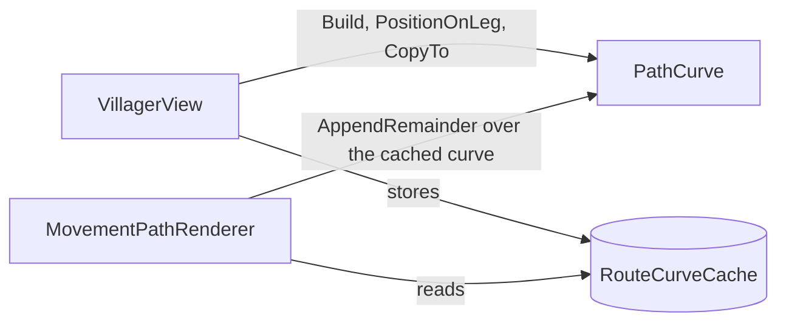

# PathCurve

> [!question] The question
> How do you round the corners of a grid path so that it reads well, while guaranteeing
> that a sprite walking it still arrives at each node on exactly the right tick?

**Where you are:** [[Home]] › [[Match]] › [[World view]] › [[Route lines]] › **PathCurve** (script)

**Open:** [PathCurve.cs in VS Code](vscode://file/C:/Dev/NodeGame/Assets/Scripts/Game/View/PathCurve.cs)

## What it is

A `static class`, about 300 lines, of pure geometry: waypoints go in, a rounded polyline
comes out, plus "where am I at fraction *t* of leg *k*?". `VillagerView` uses it to place
sprites, and `MovementPathRenderer` to draw lines. It does no rendering itself.

> [!info] The file in one breath
> `Build` (round the corners) · `PositionOnLeg` (sample by arc length) ·
> `AppendRemainder` (the part still to walk, optionally cut after N legs) ·
> `CopyTo` (take your own copy) · static scratch lists.

## Read it in this order

### 1. The header comment: *why corner rounding, not Chaikin*

Chaikin smoothing (used elsewhere for the lasso) *moves* every point. Here **every node must
stay a point on the curve**, because the simulation times each leg as
`edgeWeight × moveSpeedTicks`. If the curve didn't pass through the nodes, the sprite would
drift off the tick it's meant to arrive on. So only the corner is replaced, with a quadratic Bézier.

### 2. `Build`: one corner at a time

```
   previous ●
            │
            │ ← entry  (radius back along the incoming leg)
            ╰──╮
               ●───────● next
          corner  ↑ exit (radius along the outgoing leg)
```

- `radius` is clamped to half the shorter adjacent leg, so a tight path rounds less instead of overshooting.
- `cornerSegments` is forced **even**, so the Bézier has an exact midpoint vertex at `t = 0.5`.
  **That midpoint is recorded as the leg boundary** (`legStarts.Add(points.Count)`): the
  sprite finishes leg *k* and starts leg *k + 1* exactly there.
- The degenerate case (zero-length legs) is guarded before normalising, to avoid dividing by zero.
- A 180° turn (a reversal) needs no special case: the Bézier collapses to a straight run.

The formula at the bottom is the textbook quadratic Bézier:
`(1−t)²·a + 2(1−t)t·control + t²·b`.

### 3. `PositionOnLeg`: sampling by *length*, not by index

```csharp
float wanted = total * t;         // how far along this leg, in world units
for (...) {
    if (walked + step >= wanted)  // this segment contains it
        return Vector3.Lerp(p[i], p[i+1], (wanted - walked) / step);
    walked += step;
}
```

Segments on a curve are shorter than on a straight, so sampling by point index would make
the sprite speed up and slow down. Walking the arc length keeps the pace steady.

### 4. `AppendRemainder`: the line ahead of the sprite

Its first point is exactly what `PositionOnLeg` returns, so the line starts *on* the
sprite. `maxLegs` cuts it: *"a real truncation, not a fade: nothing past the cut is
written at all."* That's the information gate for enemy routes ([[Route lines]]). There's
also a small fix that skips a duplicate point which "a dashed material renders as a blot".

### 5. The static scratch buffers, and `CopyTo`

`points` and `legStarts` are `static readonly List`s, reused by every call, so nothing is
allocated per villager per frame. The price: **the next `Build` overwrites them**, so
anything you keep must be copied (`CopyTo`, which `RouteCurveCache` uses). It's also main-thread only and not reentrant.

## Who uses it



## Tests that pin it

`dotnet/NodeWar.View.Tests` covers the pure movement and route maths, including reversal.
Change curve or leg maths together with those tests.

## Try it

> [!example] Exercise: draw it by hand
> Take waypoints (0,0) → (4,0) → (4,4) with radius 1 and `cornerSegments = 4`. Work out
> `entry`, `exit` and the five corner points. Which index goes into `legStarts`? Then check:
> is the midpoint `(3.75, 0.25)`? (Hint: the Bézier at t = 0.5 is ¼·entry + ½·corner + ¼·exit.)

## Check yourself

> [!question]- Why must `cornerSegments` be even?
> So `s / cornerSegments` reaches exactly 0.5 at `s = half`. That vertex is the leg boundary.
> With an odd count there'd be no vertex exactly at the midpoint, and the sprite couldn't
> land on the boundary precisely.

> [!question]- What bug would appear if `MovementPathRenderer` kept a reference to `PathCurve`'s `points` list?
> The next villager's `Build` would overwrite it, and the stored route would suddenly show
> another villager's path. That's why `CopyTo` exists.

## Go deeper ↓

This is the lowest shell. Below it is the code itself.

## My understanding

<!-- Yours. AI never edits below this line. -->
