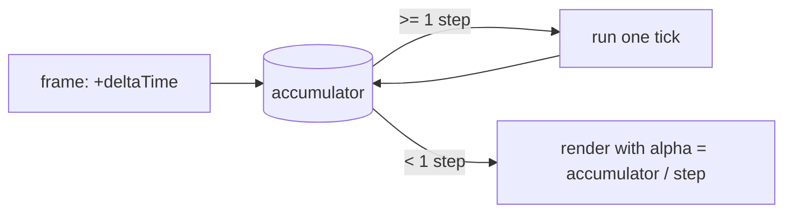

# Fixed timestep

> [!question] The question
> Frames arrive at uneven intervals: 16 ms, 17 ms, then a 250 ms hitch. How do you run game
> rules at a perfectly steady rate anyway?

**Kind:** concept. True outside Node War. Used by [[TickRunner]], [[The tick]], [[Smooth movement between ticks]] and [[Netcode]].

## The problem

The simple approach, `position += speed * Time.deltaTime`, makes the result depend on the
frame rate. A 30 fps machine and a 144 fps machine take different steps, round differently,
and detect collisions differently. For a single-player game that's a small wobble. For
lockstep it's a guaranteed desync.

## The idea

**Save up real time in an *accumulator*, and spend it in exact, fixed-size steps. Whatever
is left over is a fraction of a step, which the renderer uses to interpolate.**



```csharp
accumulator += frameTime;
while (accumulator >= step) { Simulate(); accumulator -= step; }
alpha = accumulator / step;   // 0..1, for interpolation
```

## In Node War

- **Step = 0.1 s (10 Hz).** [[TickRunner]] and `LockstepCore` both run this loop.
- **Alpha** becomes `ITickProvider.TickAlpha`, which [[Smooth movement between ticks]] uses.
- **The death spiral guard.** If one frame is very slow, the loop runs many ticks, which
  makes the next frame slow too, and so on. `LockstepCore` caps the accumulator at 3 ticks
  (`MAX_ACCUMULATOR_TICKS`) when it resumes after waiting, so it never tries to catch up on everything at once.
- **Catch-up is explicit.** When behind the peer, `LockstepCore` runs at 1.5× speed until
  it has caught up, instead of jumping ahead.
- **Floats for timing are fine** in the loop itself: they only decide *how many* ticks to
  run. Inside a tick, everything is integers.

## Why not the alternatives

| Option | Problem |
|---|---|
| Variable timestep (`× deltaTime`) | Results depend on frame rate, which is non-deterministic |
| One tick per frame | Game speed depends on frame rate. Slow machines play in slow motion |
| Semi-fixed (cap the step size) | Better than variable, but still not identical across machines |
| Unity's `FixedUpdate` | Fixed steps, but tied to Unity's physics loop and settings, which aren't available in the referee or tests |

## Traps

- **`Time.deltaTime` inside the simulation.** Banned by the determinism contract.
- **No cap on catch-up.** That's the death spiral.
- **Forgetting interpolation.** A fixed 10 Hz without alpha looks like 10 fps.

## Check yourself

> [!question]- The accumulator holds 0.27 s and the step is 0.1 s. How many ticks run, and what is alpha?
> Two ticks, leaving 0.07, so alpha is 0.7.

> [!question]- Why does Node War not just use Unity's `FixedUpdate`?
> The simulation must also run where Unity doesn't exist: the dotnet tests, the balance rig
> and the Cloud Code referee. The loop has to be plain code that the caller drives.

## Learn more

- Glenn Fiedler, [Fix Your Timestep!](https://gafferongames.com/post/fix_your_timestep/): *the* article on this.
- Robert Nystrom, [Game Loop](https://gameprogrammingpatterns.com/game-loop.html), from *Game Programming Patterns* (free online).

## My understanding

<!-- Yours. AI never edits below this line. -->
