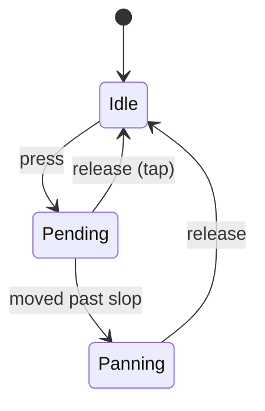

# State machines

> [!question] The question
> When something can be in many situations and the right reaction depends on which one it's
> in, how do you keep the logic from becoming a tangle of flags?

**Kind:** concept. True outside Node War. Used by [[Gesture recognition]] and [[GestureClassifier]].
Villagers are another one: `VillagerState` is Idle, Moving, Fighting, Claiming, Dead…

## The idea

**Name every situation as a *state*. Keep exactly one current state. List the *transitions*:
in state S, when event E happens, go to state T (and maybe do something). Anything not
listed is ignored.**

## Why it beats flags

With flags (`isDragging`, `isHolding`, `isLassoing`, `wasTap`…), *n* booleans give 2ⁿ
combinations, and most of them are nonsense ("dragging *and* lassoing *and* tapped"). Bugs
live in those combinations. One `State` field makes impossible combinations impossible to represent.

## In Node War

- `GestureClassifier.State`: 12 states, transitions in `ProcessFrame` / `Continue` / `End`.
- `VillagerData.state`: the simulation's per-unit state machine. A Move order *during* Fighting
  changes only intent, and the state change happens in the tick's resume step.

## Traps

- **Transitions scattered across files.** Keep them in one place, as the classifier does.
- **Doing work in the wrong state.** `switch (State)` makes "in which state does this run?" explicit.
- **Forgetting the cancel or exit path from every state.**

## Learn more

- Robert Nystrom, [State](https://gameprogrammingpatterns.com/state.html), from *Game Programming Patterns*

## My understanding

<!-- Yours. AI never edits below this line. -->
