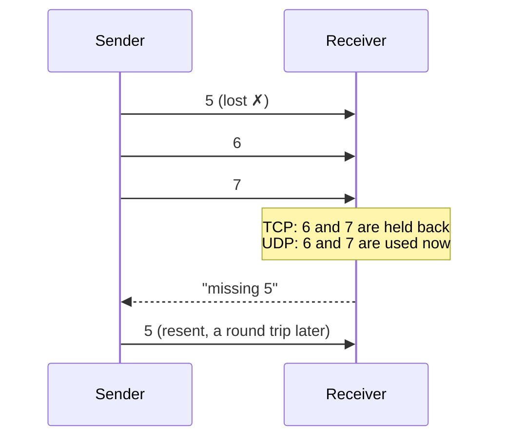

# UDP vs TCP

> [!question] The question
> The internet offers two basic ways to send data. Why do real-time games almost always
> pick the "unreliable" one?

**Kind:** concept. True outside Node War. Used by [[Netcode]], [[Tick packets]] and [[Backend]].

## The problem

The internet is a postal service that sometimes loses letters, sometimes delivers them
out of order, and occasionally delivers one twice. Programs need a *contract* on top of
that. The two common contracts make opposite promises.

## The idea

**TCP promises that everything arrives, in order, and makes you wait for it. UDP promises
nothing and never makes you wait, so you build only the reliability you actually need.**

## How it works

| | TCP | UDP |
|---|---|---|
| Unit | A continuous stream of bytes | Separate packets (datagrams) |
| Lost data | Resent automatically | Gone, unless you resend it yourself |
| Order | Guaranteed | Not guaranteed |
| Duplicates | Removed | Possible |
| Connection setup | A handshake before any data | None: just send |
| The catch | **Head-of-line blocking** | You write the reliability you need |

**Head-of-line blocking** is the key idea. If TCP loses packet 5, packets 6, 7 and 8 may
already have arrived, but your program can't read them until 5 is resent and lands, which
takes at least one round trip and often more. For a file download that's fine. For a game,
packets 6–8 held *newer* information, and the whole game waits on the oldest one.

## In Node War

- **In a match: UDP.** Unity Transport runs over UDP, either directly or through Unity
  Relay (which adds DTLS encryption). Node War builds exactly the reliability it needs on top:
  - *Loss* → every input is sent seven times ([[Tick packets]]).
  - *Reordering* → it doesn't matter, because each packet names its own tick (`forTick`).
  - *Duplicates* → ignored, because inputs are stored by tick and a second copy is skipped.
- **Talking to the backend: TCP.** Cloud Code, Cloud Save and Matchmaker calls go over
  HTTPS, which runs on TCP. A rating update must arrive completely and exactly once, and
  nobody minds 50 ms of waiting.

> [!tip] The rule of thumb
> If newer data makes older data useless (positions, inputs racing a deadline) → UDP.
> If every byte matters and waiting is acceptable (saves, purchases, results) → TCP.

## Why not the alternatives

- **TCP for gameplay:** a single lost packet stalls everything behind it. In lockstep that
  is a frozen game.
- **Reliable mode on UDP** (Unity Transport has a reliable pipeline): it would re-create
  TCP's acknowledge-and-resend round trip. Node War's copies-in-advance approach recovers
  faster, because no round trip is needed.
- **QUIC / WebTransport:** a modern protocol over UDP that removes head-of-line blocking
  between streams. Worth knowing about for browser games, but it isn't needed here.

## Traps

- **Treating UDP as "TCP without the overhead".** On UDP, *you* own loss, order and
  duplicates. Forget one and you get a rare bug that shows up only on bad connections.
- **Big UDP packets.** A datagram larger than the path's maximum size (the MTU, about
  1,500 bytes on Ethernet, less after headers) can be split or dropped. Keep packets small.
- **Assuming one packet means one message.** On TCP it doesn't (TCP is a stream); on UDP it does.

## Check yourself

> [!question]- Node War ignores packet order entirely. What makes that safe?
> Each packet carries `forTick`, so the receiver files it in the right place whenever it
> arrives. Order only matters when the meaning depends on position in a stream.

> [!question]- Why is the ranked result upload *not* sent over UDP?
> It's one important message where waiting is fine and losing it is not. TCP's guarantees
> (via HTTPS) are exactly right, and the upload retries until the server answers.

## Learn more

- Glenn Fiedler, [UDP vs. TCP](https://gafferongames.com/post/udp_vs_tcp/): the classic
  explanation from a game-networking veteran.
- Glenn Fiedler, [Deterministic Lockstep](https://gafferongames.com/post/deterministic_lockstep/):
  the model Node War uses, including redundant inputs.
- Terrano & Bettner, [1500 Archers on a 28.8](https://www.gamedeveloper.com/programming/1500-archers-on-a-28-8-network-programming-in-age-of-empires-and-beyond):
  how Age of Empires did lockstep over dial-up. Node War's ancestor.
- Gabriel Gambetta, [Fast-Paced Multiplayer](https://www.gabrielgambetta.com/client-server-game-architecture.html):
  the client-server alternative, explained interactively.

## My understanding

<!-- Yours. AI never edits below this line. -->
