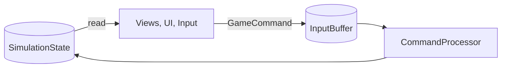

# 🔁 Presentation reads, never writes

> [!question] The question
> Why does every view, panel and input script in Node War treat `SimulationState` as
> read-only, with exactly one door (the `InputBuffer`) for changing anything?

**Kind:** pattern. An idea that recurs at different shells of this codebase.

## The pattern

**Everything the player sees and touches may *read* the game freely and decorate it with
floats, animation and fades. Changing the game happens *only* by submitting a command.**

## Where you've seen it

| Shell | Where | The read | The single write path |
|---|---|---|---|
| 0 | [[Match]] | Views draw the state | Every change is a command |
| 1 | [[Input]] | "Is this villager selectable?" | `IssueMoveTo` → buffer |
| 1 | [[Commands]] | `CommandEligibility` greys out buttons | Buttons enqueue commands |
| 1 | [[World view]] | Interpolation, routes, effects | None. "Read-only over SimulationState" |
| 2 | [[Pending orders]] | Previews computed from state | "Never writes a command" |
| 2 | [[Route lines]] | Routes computed from state | None |

## What it buys

- **Determinism survives presentation code.** Floats, frame times and tweening can't leak into the game.
- **Replays and the referee need no views.** The game is complete without them.
- **One place to validate.** Every change passes through `CommandProcessor`.

## What it costs

- **Latency is visible.** You can't "just move it now", so you need [[Hide latency with honest previews]].
- **Duplicated checks.** UI eligibility mirrors processor rules and can drift.
- **Views must survive the state changing under them** (rollback, arrays growing).

## Where it doesn't apply

The **draft** runs before any `SimulationState` exists. It has its own version of the
pattern: the screen reads `DraftState` and changes it only through `ConfirmLocalPlacement`
(`.claude/rules/view-ui.md`). Same pattern, different subject.

## Spot it yourself

> [!question]- Unity UI's MVC/MVVM patterns (model, view, view-model) also separate reading from writing. How is Node War's version stricter?
> In typical MVVM, a view-model can write the model directly. Here even that write must be
> serialised as a command, because it has to happen identically on another machine, ticks later.

## My understanding

<!-- Yours. AI never edits below this line. -->
